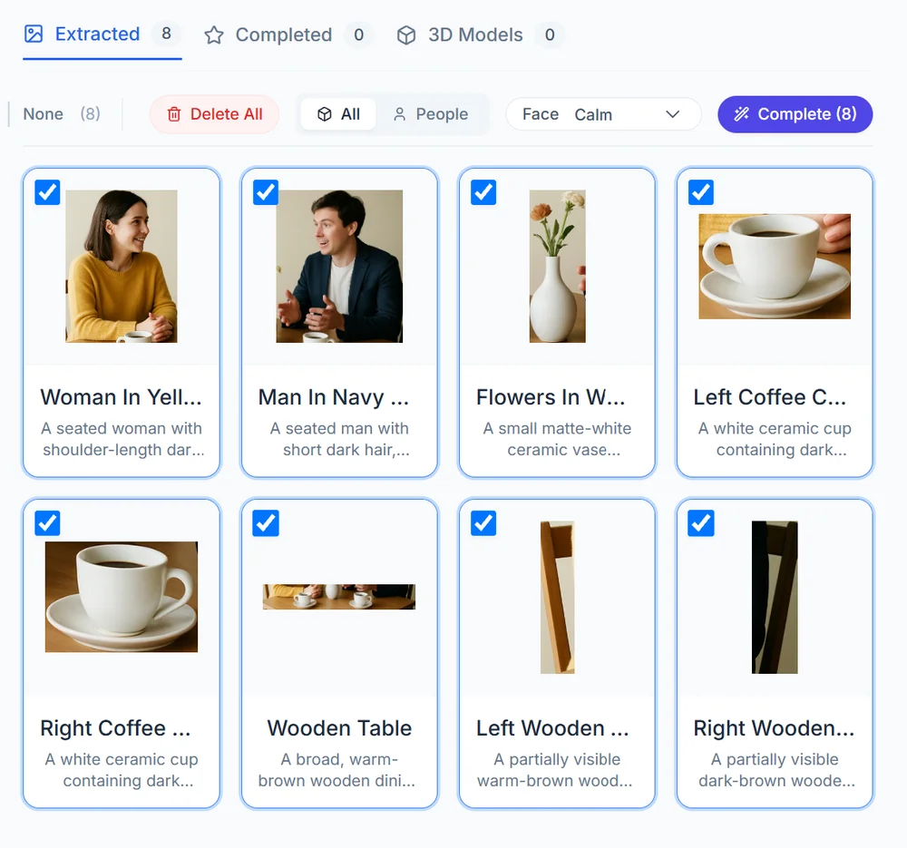

# One Image to 3D Scene

[English](README.md)

**単眼RGB画像1枚**から3Dシーンを復元するシステムです。

複数視点の画像や深度センサーから点群を復元する従来の方法とは異なり、本システムは**オブジェクトベース**のアプローチをとります。画像内の物体を一つずつ認識し、隠れている部分や画像の外にはみ出した部分を生成AIで補完し、物体ごとに3Dモデルを生成してから、単眼深度推定を使って3D空間に配置します。

[引用](#引用) に記載した論文の実装です。

<table>
  <tr>
    <td></td>
    <td></td>
  </tr>
  <tr>
    <td align="center">入力：1枚の写真</td>
    <td align="center">復元した3Dシーン</td>
  </tr>
</table>

サンプル画像 [`samples/two-people-at-table.webp`](samples/two-people-at-table.webp) は生成AIで作成したもので、論文でも入力として使っています。アプリを試す際にお使いください。

## 処理の流れ

| # | フェーズ | 手法 |
|---|---|---|
| 1 | 物体検出 | VLM（OpenAI または Gemini）でバウンディングボックス、ラベル、詳細な説明（姿勢・動作・服装）を取得 |
| 2 | 切り出し | HTML5 Canvas API |
| 3 | 画像補完 | 生成AI（OpenAI または Gemini の画像生成）によるアウトペインティングで、姿勢を保ったまま隠れた部分や切れた部分を復元。OpenAI は透明背景で返し、Gemini の場合は背景を除去（BRIA RMBG 2.0 または 3.0） |
| 4 | 見えていた部分の特定 | 補完の間、切り出し画像を既知の枠に保つ（出力と同じ大きさのキャンバス、OpenAI の編集マスク）。その枠の近くを相関で探して確認・補正する。生成AIが動かした場合だけ、AKAZE（OpenCV.js）、Lowe's Ratio Test、RANSAC による拡大率と移動量の推定に戻る |
| 5 | 深度推定 | Depth Anything V2。物体の深度はマスク内の深度の中央値 |
| 6 | 3D生成 | TRELLIS.2 または Hunyuan3D-2.1（Hugging Face Spaces）でテクスチャ付きGLBを生成 |
| 7 | シーン合成 | Three.js。深度マップから作った点群のバウンディングボックス（PC Box）にモデルを合わせて配置。既定では遠近を考慮して3次元に戻す（使い方を参照） |
| 8 | 向き合わせ | 各モデルを縦軸まわりに回して描画し、補完画像と比べる（シルエット、縦横比、明暗）。一致する向きに回し、さらに視線方向の角度だけ回して、写真と同じようにカメラに向ける |

### 処理の流れ（サンプル画像）

最新版で、OpenAI（物体検出と画像補完。補完の画像の右の椅子は Gemini で補完）と TRELLIS.2（3D生成）を使った結果です。人物は顔の描き方 **Calm** で補完しました。3Dシーンは、遠近を考慮した配置（遠/近の比 1.5）、補完を通して保った見えていた部分の枠による論文の箱による配置、各モデルの補完画像への向き合わせを使っています。

<table>
  <tr>
    <td width="50%"><br><sub><b>1. 物体検出</b>：VLM が8物体のラベルと枠を取得</sub></td>
    <td width="50%"><br><sub><b>切り分け</b>：各物体の見えている画素（ブラウザ内の SAM 2.1、枠をプロンプトに使用）。両端の椅子は背もたれの細い部分だけが見えている</sub></td>
  </tr>
  <tr>
    <td width="50%"><br><sub><b>2. 切り出し</b>：物体ごとに写真から切り出す</sub></td>
    <td width="50%"><br><sub><b>3. 画像補完</b>：隠れた部分を透明背景で生成。見えていた部分が位置を保った（緑の枠、「Part: kept」）ので、特徴点マッチングは不要</sub></td>
  </tr>
  <tr>
    <td width="50%"><br><sub><b>6. 3D生成</b>：物体ごとにテクスチャ付き3Dモデルを生成（TRELLIS.2）</sub></td>
    <td width="50%"><br><sub><b>5. 深度推定</b>：Depth Anything V2（明るいほど手前）</sub></td>
  </tr>
  <tr>
    <td width="50%"><br><sub><b>7. シーン合成</b>：8物体すべてを遠近を考慮して PC Box の奥行きに配置。背もたれの細い部分しか見えない椅子も、人物の後ろに置かれる。天板の手前しか見えないテーブルの位置は、まだおおよそ</sub></td>
    <td width="50%"><br><sub><b>3D Scene タブ</b>：操作パネル付きのシーン。深度の範囲と点の大きさ、<b>Perspective</b>、<b>Align</b>（向き合わせ）、各種の枠と点群、配置の <b>Save</b> / <b>Load</b>、モデルを手で動かす <b>Edit</b></sub></td>
  </tr>
  <tr>
    <td width="50%"><br><sub><b>手で編集した結果</b>：シーンの編集モード（<b>Edit ON</b>。移動・回転・拡大の操作つまみが表示されている）で、テーブルと椅子の位置と大きさを直したもの。天板の手前しか見えないテーブルが、最も直す必要があった</sub></td>
    <td width="50%"></td>
  </tr>
</table>

## 必要な環境

- Node.js 18以上
- **OpenAI または Google Gemini の APIキー**（物体検出と画像補完で別々のプロバイダーを使う場合は両方）
- **Hugging Face トークン**（TRELLIS.2 / Hunyuan3D-2.1 による3D生成では必須。背景除去と深度推定でも推奨。ZeroGPUの利用分が各自の枠で計上されます）。Hugging Face の **Settings → Access Tokens** で **Read** のトークンを作り、アプリの画面右上の **HF Token** 欄に入力します。詳しくは [docs/hugging-face-spaces-jp.md](docs/hugging-face-spaces-jp.md) を参照してください

## セットアップ

```bash
git clone https://github.com/IWATSUKI-Masami/one-image-to-3d-scene.git
```

```bash
cd one-image-to-3d-scene
```

```bash
npm install
```

APIキーは画面上で入力するか、`.env.local` に書きます（`.env.example` をコピーしてください）。

```bash
cp .env.example .env.local
```

```bash
npm run dev
```

ブラウザで `http://localhost:3000` を開きます。

> [!WARNING]
> `VITE_` で始まる環境変数は、ビルド時に**JavaScriptにそのまま埋め込まれます**。また、APIはブラウザから直接呼び出されます。手元で動かす分には問題ありませんが、**キーを含んだビルドを公開サーバーにデプロイしないでください**。誰でもキーを読めてしまいます。公開する場合は `.env.local` を空にし、利用者それぞれが画面でキーを入力する形にしてください。

## AIプロバイダーとモデル

**AI Settings** はアプリの設定画面です。画面右上、HF Token の入力欄の左隣にある丸いボタンから開きます。ボタンの表示は、API キーが未設定のときは **Set API Keys**（灰色）、設定済みのときは **AI: Gemini / Gemini** のように使っているプロバイダー名（緑色）になります。API キーが必要な処理をキーなしで始めた場合も、自動で開きます。

AI Settings では次の項目を設定できます。

| 項目 | 内容 |
|---|---|
| Object detection & checks | 物体検出・チェックに使う AI（OpenAI / Gemini。既定は OpenAI） |
| Image completion | 画像補完に使う AI（OpenAI / Gemini。既定は OpenAI） |
| Background removal | 背景除去のモデル（RMBG 2.0 / RMBG 3.0。既定は RMBG 2.0）。Gemini で補完するときだけ使い、OpenAI を選んでいる間は選択できない |
| API keys | OpenAI と Gemini の API キー |
| Models | 使うモデルの ID |
| Hugging Face Spaces | 背景除去・深度推定・3D 生成で使う Space の ID（複製した Space など） |

既定のモデルは次のとおりです。

| 処理 | プロバイダー | 既定のモデル |
|---|---|---|
| 物体検出、キャンバス拡張量の推定、補完結果のチェック | OpenAI / Gemini | `gpt-5.6-sol` / `gemini-pro-latest` |
| 画像補完（アウトペインティング） | OpenAI / Gemini | `gpt-image-2.6-sunburst` / `gemini-3-pro-image` |

- OpenAI は補完画像を透明背景で返します。Gemini は透明背景を出力できないため、補完後に背景除去を行います。背景除去に失敗した場合は、補完画像のカードに表示されます。
- 物体検出と画像補完の既定は、どちらも OpenAI です。
- 背景除去には **BRIA RMBG 2.0**（既定）または **BRIA RMBG 3.0** を使います。AI Settings の **Background removal** で選べます。OpenAI で補完している間は背景除去を使わないので、選択できなくなります。どちらの Space も API は同じです。RMBG 2.0 はずっと軽く、複製すれば T4 で動きます。
- モデルIDは頻繁に変わります。モデルが提供終了になった場合は、AI Settings で新しいIDを入力してください。コードの変更は不要です。
- 論文の結果は `gemini-3-pro-preview` と `gemini-3-pro-image-preview`（どちらも提供終了）で得たものです。他のプロバイダーやモデルでも同じプロンプトを使いますが、検出精度や姿勢の保持には差が出る可能性があります。
- APIキーはメモリ上にだけ保持します。プロバイダーとモデルIDはブラウザに記憶されます。

### Hugging Face Spaces

背景除去、深度推定、3D生成では、次の Space を呼び出します。AI Settings の **Hugging Face Spaces** で変更できます。

| 処理 | 既定の Space |
|---|---|
| 背景除去（RMBG 3.0 / 2.0） | `briaai/BRIA-RMBG-3.0`、`briaai/BRIA-RMBG-2.0` |
| 深度推定 | `depth-anything/Depth-Anything-V2` |
| 3D生成 | `microsoft/TRELLIS.2`、`tencent/Hunyuan3D-2.1` |

公式の Space は ZeroGPU で動いており、利用者ごとに1日の利用枠があります（Hugging Face PRO では枠が大きくなります）。多数の物体を処理する場合は、Space を自分のアカウントに複製し（Space のページの **Duplicate this Space**）、専用 GPU を割り当てて、その ID を入力してください。専用 GPU は時間課金なので、使い終わったら Space を一時停止してください。

**手順の詳細**（トークン、モデルの利用規約への同意、シークレット `HF_TOKEN`、Hunyuan3D-2.1 の複製に必要な修正、よくあるエラー）は [docs/hugging-face-spaces-jp.md](docs/hugging-face-spaces-jp.md) にまとめています。

- **TRELLIS.2**：**A100**（80GB）を使ってください。TRELLIS.2 の開発元は 24GB 以上を必要とし、動作確認は A100/H100 だけです。また、Space は特定の GPU 向けにビルド済みの CUDA 拡張機能を読み込むため（今の公式 Space は ZeroGPU の GPU 向け）、それより小さい GPU や種類の違う GPU では動かないことがあります。
- **Hunyuan3D-2.1**：**A100**（80GB）を使ってください。形状とテクスチャの生成に約 29GB が必要で、Space は CUDA 拡張機能を A100/A10G 系の GPU 向けにビルドします。公式の Space は ZeroGPU 用なので、複製した場合はいくつかのファイルの修正（Python 3.10、Gradio 5.33.0、torch の固定、bpy の除去、`custom_rasterizer` のソースからのコンパイル、`zero.startup()` の無効化）が必要です。上の手順の詳細を参照してください。
- **深度推定**：T4 で十分です。
- **背景除去**：BRIA RMBG 3.0 は約 25GB（bf16 の重み）の4ステップの拡散モデルなので、**L40S** など 48GB の GPU が必要です。T4 や 24GB の GPU ではメモリが不足します。T4 を使う場合は、RMBG 2.0 を選び、`briaai/BRIA-RMBG-2.0` を複製してください。なお、RMBG 3.0 のモデルはゲート付きです。`briaai/RMBG-3.0` と `briaai/Fibo-2.0-edit-turbo` の利用規約に同意し、HF トークンを Space のシークレット `HF_TOKEN` として登録してください。
- **OpenAI で補完する場合**は背景がすでに透明なので、背景除去の Space はまったく不要です。
- BRIA RMBG のモデルは非商用利用（CC BY-NC 4.0）として公開されています。それ以外の用途では、モデルカードを確認してください。非公開の Space には、読み取り権限のある HF トークンが必要です。

## 使い方

1. **Detect & Crop**：画像をアップロードしてシーンを解析します。検出された物体は自動で切り出されます。
   - **Segment Objects**（任意。写真の上）：検出した各物体の見えている画素を、その枠をプロンプトにして [SAM 2.1](https://huggingface.co/onnx-community/sam2.1-hiera-small-ONNX) で切り分けます。ブラウザ内で動き（transformers.js。WebGPU があれば使い、なければ WebAssembly）、API キーやトークンは不要です。モデル（約 70〜90 MB）は初回に Hugging Face からダウンロードされ、ブラウザにキャッシュされます。マスクは写真に重ねて表示され（**Masks** チェックボックス）、プロジェクトに保存されます。各物体の奥行き（式(4)）には、補完画像の透明度の代わりにこのマスクを使います。補完で物体の画素だけを描いて固定するのにも使います（手順2）。
2. **Image Completion**：切り出した物体を補完します（人物は全身、物体は欠けた部分）。補完後に背景が除去されます。まず VLM が、写真全体を見て、各物体が枠の外へ各方向にどこまで続いているかを推定します。切り出し画像は、画像生成AIの出力と同じ大きさのキャンバスに、隠れた部分の余白を取って置かれます。写真を切り分けてある場合（**Segment Objects**）は物体の画素だけを描き、OpenAI では編集マスクでその部分を変更不可にします。見えていた部分が位置を保てば（枠の近くを相関で探して確認。生成AIによる小さなずれや大きさの変化も補正）、補完画像の中でのその枠が、特徴点マッチングなしで分かります（カードの表示「Part: kept」）。保てなかった場合は AKAZE マッチングを使います（「Part: matched」）。補完の結果は、切れている部分や不自然な比率（脚が短いなど）がないかを確認し、あれば最大2回までキャンバスを広げてやり直します。見えていた部分の位置が保たれなかった場合は同じキャンバスでやり直し、最大3回のうち最もよい結果を使います。また、物体を赤い枠で示した写真全体を、見た目と向きの参考として生成AIに渡します。**Face** で人物の顔の描き方を選べます。**Calm**（既定。顔をくっきり描き、口を閉じた穏やかな表情にする。開いた口や歯は3Dで不気味に見えやすいため）、**Redraw**（顔をくっきり描き、表情はそのまま）、**Mannequin**（目鼻を描かないマネキン風）、**As in photo**（写真のまま）です。Completed のカードには、補完に使ったサービスと顔の描き方（例：「OpenAI · Face: Calm」）が表示されます。人物の3Dモデルは、オプションによらず高い解像度で生成します。
3. **3D Generation**：補完した画像から3Dモデルを生成します。3D生成モデルは、補完画像の視点を保つとは限りません（斜めから見た椅子が別の向きで作られるなど）。そこで、生成したモデルを縦軸まわりの各角度で描画して補完画像と比べ（シルエットの重なり、縦横比、明暗）、最もよく一致する角度だけモデルを回して、正面の姿を補完画像に合わせます（向き合わせ）。モデルのカードの表示、見えていた部分の枠、3Dシーンのすべてでこの向きを使います。シーンの **Align** チェックボックスでオフにできます。
4. **3D Scene**：深度マップを生成し、組み立てられたシーンを表示します。位置はTransformControlsで調整でき、glTF/GLBで書き出せます。
   - **Perspective**（チェックボックス。既定でオン）：点群、PC Box、モデルを、原点に置いたピンホールカメラ（水平画角 60° と仮定）から3次元に戻します。深度マップは、Depth Anything V2 の出力どおり視差（距離の逆数）として読みます。Depth Anything V2 は画像ごとに出力を全範囲に引き伸ばすので、一番遠い点と一番近い点の距離の比は分かりません。Perspective がオンのときは、**Depth** スライダーでこの比（遠/近）を設定します（既定 1.5。サンプル写真で、カップと人物の頭の大きさの比が現実的になる値です。奥行きの大きい場面では大きくしてください）。物体は現実の大きさの比を保つので、カメラの近くのカップが奥の人物と同じくらいの大きさになることはありません。また、最初のカメラの位置（写真のカメラの位置）から見ると、写真と同じ見え方になります。**チェックを外すと、論文の配置を再現します**。論文の配置では、物体を画像上の大きさのまま置き、明るさを直線的に距離に対応させるので、カメラに近い物体ほど大きくなりすぎます。
プロジェクト（画像、深度マップ、モデル、配置）は保存と読み込みができます。

### 費用：AI の使用量を抑えるには

自動での配置は正確さを優先しているため、API の呼び出し（OpenAI / Gemini のクレジット）と GPU の時間を使います。

| 手順 | 呼び出し |
|---|---|
| 物体検出 | 写真1枚につき VLM を1回 |
| 画像補完（物体ごと） | VLM を1回（物体が枠の外へどこまで続くか）。その後、1回の試行ごとに画像生成を1回（写真全体を2枚目の参考画像として渡す）と VLM による確認を1回。切れている部分がある、比率が不自然、見えていた部分が動いた場合は、最大3回まで試行を繰り返す。1つの物体で、画像生成が最大3回、VLM が最大4回になる。**Attempts: 1** にすると、画像生成1回と VLM 1回 |
| 3D生成（物体ごと） | Hugging Face の Space を1回（GPU の時間・ZeroGPU の利用枠。API のクレジットではない）。人物は高い解像度で生成する |
| Segment Objects、向き合わせ、深度による配置 | ブラウザ内で実行（深度マップは写真1枚につき Space を1回）。API のクレジットは使わない |

試行の繰り返しは、物体を自動で正しく配置するためのものです。**自動での配置の正確さにこだわらず、シーンを自分で調整するなら、必要な機能だけを使ってください。**

- **Complete** の隣の **Attempts** を **1 (fewest credits)** にする：各物体の補完を1回だけ行い、確認とやり直しをしない。
- 補完と3D生成は、必要な物体だけに行う（カードを選択する）。たとえば、一部しか写っていない椅子やテーブルは除く。
- 最初の結果を使う：カードに「Part: matched」や「Part: not found」と出ても補完し直さず、配置を手で直す。
- シーンを手で調整する：3Dシーンで **Edit ON** にしてモデルをクリックし、移動・回転・拡大縮小の操作で直す（リセットボタンで元に戻せる）。シーンのパネルの **Save** で配置を保存できる。
- Segment Objects、向き合わせ、3Dシーン自体はクレジットを使わないので、オンのままでよい。


## ディレクトリ構成

```
├── App.tsx                 # メインアプリ（UIと処理の流れ）
├── components/             # Reactコンポーネント（3Dビューア、カード、オーバーレイ）
├── services/
│   ├── aiService.ts        # 物体検出・補完・チェックのプロンプト
│   ├── segmentation.ts     # 写真上の物体マスク（ブラウザ内の SAM 2.1）
│   ├── frontAlignment.ts   # モデルの向きを補完画像に合わせる（描画して比べる）
│   └── ai/                 # プロバイダー層（OpenAI / Gemini）と既定のモデル
├── utils.ts                # 切り出し、AKAZEマッチング、深度推定、3D生成API
├── types.ts                # 型定義
├── samples/                # サンプル画像
└── docs/                   # Hugging Face Spaces の手順、開発の経緯、今後の拡張、README の画像
```

## 今後の拡張

3D生成への [Pixal3D](https://huggingface.co/TencentARC/Pixal3D)（ピクセル整合型の画像-to-3D）の追加と、[ComfyUI](https://www.comfy.org/) による手元の GPU での3D生成、模様の少ないごく一部しか写っていない物体（天板の手前の端しか見えないテーブルなど）の配置の改善、向き合わせでの対称に近い物体の前後の取り違えへの対処、カメラの画角と遠/近の距離の比の較正（遠近を考慮した配置は、今は画角 60° を仮定）、人物の顔の改善を予定しています。詳しくは [docs/roadmap-jp.md](docs/roadmap-jp.md) を参照してください。

## 引用

研究で利用される場合は、以下の論文を引用してください。

岩月 正見, 渡邊 瑞輝, 「単眼画像からの深度ベース高精度3Dシーン復元 ―生成AIによるオブジェクトベースアプローチ―」, 信学技報, KBSE2025-61, pp.73–78, 2026年3月.

```bibtex
@techreport{iwatsuki2026oneimage3d,
  author      = {Iwatsuki, Masami and Watanabe, Mizuki},
  title       = {Depth-Based High-Precision {3D} Scene Reconstruction from a Single Monocular Image: Object-Based Approach Using Generative {AI}},
  institution = {The Institute of Electronics, Information and Communication Engineers},
  type        = {IEICE Technical Report},
  number      = {KBSE2025-61},
  pages       = {73--78},
  year        = {2026},
  month       = mar
}
```

## ライセンス

[MIT](LICENSE)

このリポジトリに含まれるのはアプリケーションのコードのみです。呼び出している外部のモデルやAPI（Gemini、OpenAI、TRELLIS.2、Hunyuan3D-2.1、Depth Anything V2、BRIA RMBG 3.0 / 2.0、SAM 2.1 など）には、それぞれのライセンスと利用規約が適用されます。特に商用で利用する場合は、事前に確認してください。

特に [Tencent Hunyuan 3D 2.1 Community License](https://github.com/Tencent-Hunyuan/Hunyuan3D-2.1/blob/main/LICENSE) は、EU、英国、韓国では適用されません。これらの地域では TRELLIS.2（MIT）を使ってください。

## 更新履歴

[CHANGELOG.md](CHANGELOG.md) を参照してください。公開前の開発は非公開のリポジトリで行いました。その経緯は [docs/development-history-jp.md](docs/development-history-jp.md) にまとめています。
