# One Image to 3D Scene

[English](README.md)

**単眼RGB画像1枚**から3Dシーンを復元するシステムです。

複数視点の画像や深度センサーから点群を復元する従来の方法とは異なり、本システムは**オブジェクトベース**のアプローチをとります。画像内の物体を一つずつ認識し、隠れている部分や画像の外にはみ出した部分を生成AIで補完し、物体ごとに3Dモデルを生成してから、単眼深度推定を使って3D空間に配置します。

[引用](#引用) に記載した論文の実装です。

<table>
  <tr>
    <td>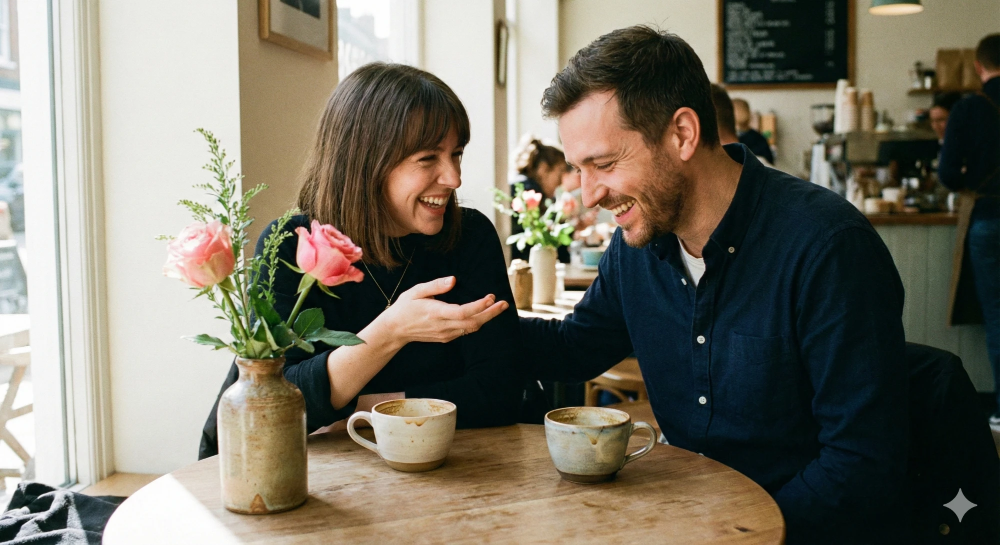</td>
    <td>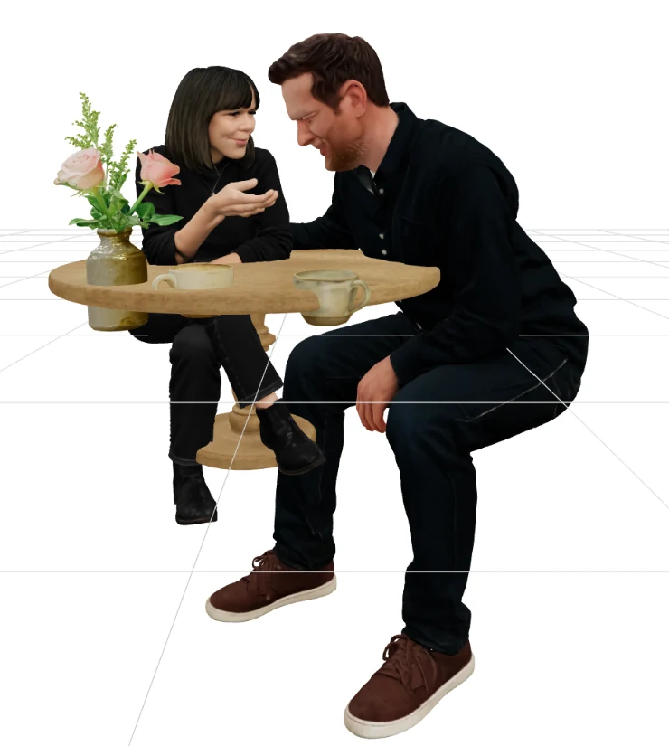</td>
  </tr>
  <tr>
    <td align="center">入力：1枚の写真</td>
    <td align="center">復元した3Dシーン（自動、写真のカメラの位置から見たもの）</td>
  </tr>
</table>

サンプル画像はすべて生成AIで作成したもので、アプリを試す際にお使いください。上の [`samples/cafe-couple.webp`](samples/cafe-couple.webp) は Gemini で作成しました。[`samples/table-talk.webp`](samples/table-talk.webp) は論文で入力として使ったもので、下の「処理の流れ（サンプル画像）」でも使っています。ほかの場面での試験には、次の2枚を使いました。[`samples/office-desk.webp`](samples/office-desk.webp) は人物のいない机の写真で、右端で切れた椅子、机に隠れたオフィスチェア、画面の背面側から見たノートPCを含みます。[`samples/woman-at-desk.webp`](samples/woman-at-desk.webp) はL字型の机に横向きで座る人物の写真で、本棚とフロアランプが画像の端で切れています（VLM が机を長方形と記述した場合は、注釈を「L字型」に直してください）。

上の3Dシーンは自動で配置した結果です。配置は、3D Scene タブの編集モード（**Edit ON**）で手で調整することもできます（下の「手で編集した結果」を参照）。

<p align="center">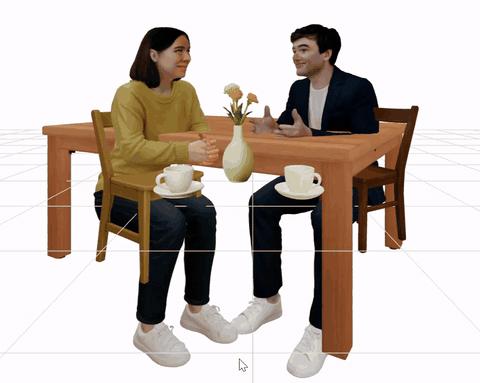</p>
<p align="center"><sub>論文のサンプルの3Dシーンを、アプリで回したところです（自動の配置）。処理の流れ全体のデモ動画：<a href="docs/videos/demo-ja.mp4"><code>docs/videos/demo-ja.mp4</code></a>（24秒、正方形、日本語字幕）、<a href="docs/videos/demo.mp4"><code>docs/videos/demo.mp4</code></a>（33秒、英語字幕）</sub></p>

手法と実装の解説記事を Qiita に書きました：[生成AIで隠れた部分を描き足しても位置がずれない：1枚の写真から3Dシーンを組み立てる](https://qiita.com/miwastsuki2026/items/08ce2be1fc32118401ae)

## 特徴

- **一部しか写っていない物体も、正しい大きさで置ける。** 生成AIが隠れた部分を描き足す間も、見えている部分を決まった位置に保つので、補完画像の中でのその位置が特徴点マッチングなしで分かり、それを基準に3Dモデルを置けます。論文のサンプルの両端の、背もたれの細い部分しか見えない椅子も、人物の後ろに立ちます。
- **描画して比べて、向きを合わせる。** 各3Dモデルを縦軸まわりに回しながら描画して補完画像と比べ（シルエット、縦横比、明暗）、写真と同じようにカメラの方へ向けます。
- **写真を理解してから配置し直す AI。** **Arrange** では、画像を読める AI がまず元の写真を解析します（現実の大きさと、何が何の上に載り、誰が何に向かって座るかといった関係）。そのうえで、描画を写真と比べ、物理的な検査と関係の検査を確かめながら、3Dシーンを数回に分けて直します。指示文はどの写真にも共通の一般的な規則だけで、テスト写真に合わせたものはありません。Claude では、開発に使っていない2枚を含む4枚のサンプル写真すべてで、物理的な問題が 0 になりました（[AI による意味を考えた配置替え](#ai-による意味を考えた配置替えarrange) を参照）。
- **ブラウザで動く。** React と Three.js で作られ、物体マスク（SAM 2.1）と向き合わせはブラウザ内で計算します。物体検出と補完には各自の OpenAI または Gemini の APIキーを、3D生成には Hugging Face の Space を使います。

## 処理の流れ

| # | フェーズ | 手法 |
|---|---|---|
| 1 | 物体検出 | VLM（OpenAI または Gemini）でバウンディングボックス、ラベル、詳細な説明（姿勢・動作・服装）を取得 |
| 2 | 切り出し | HTML5 Canvas API |
| 3 | 画像補完 | 生成AI（OpenAI または Gemini の画像生成）によるアウトペインティングで、姿勢を保ったまま隠れた部分や切れた部分を復元。OpenAI は透明背景で返し、Gemini の場合は背景を除去（BRIA RMBG 2.0 または 3.0） |
| 4 | 見えていた部分の特定 | 補完の間、切り出し画像を既知の枠に保つ（出力と同じ大きさのキャンバス、OpenAI の編集マスク）。その枠の近くを相関で探して確認・補正する。生成AIが動かした場合だけ、AKAZE（OpenCV.js）、Lowe's Ratio Test、RANSAC による拡大率と移動量の推定に戻る |
| 5 | 深度推定 | Depth Anything V2。物体の深度はマスク内の深度の中央値 |
| 6 | 3D生成 | TRELLIS.2 または Hunyuan3D-2.1（Hugging Face Spaces）でテクスチャ付きGLBを生成 |
| 7 | シーン合成 | Three.js。深度マップから作った点群のバウンディングボックス（PC Box）にモデルを合わせて配置。既定では遠近を考慮して3次元に戻す（使い方を参照） |
| 8 | 向き合わせ | 各モデルを縦軸まわりに回して描画し、補完画像と比べる（シルエット、縦横比、明暗）。一致する向きに回し、さらに視線方向の角度だけ回して、写真と同じようにカメラに向ける |
| 9 | 意味を考えた配置替え（任意） | 3Dシーンの **Arrange**：画像を読める AI（既定は Claude。OpenAI や Gemini も選べる）が、まず写真を解析し（どんなシーンか、物体ごとの現実の大きさ、何が何の上に載り、誰が何に向かって座るかなどの関係）、次に写真とシーンの描画（写真のカメラの位置から見たもの、上から見たもの、斜め上から見たもの）を比べ、ツールでモデルを移動・回転・拡大縮小して、物が台の上に載り、座っている人が椅子に座り、大きさと向きが写真に合うように直す。直すたびに新しい描画を見て確かめる |

### 処理の流れ（サンプル画像）

最新版での結果です。物体検出と画像補完には OpenAI（補完の画像の右の椅子だけは Gemini）、3D生成には TRELLIS.2 を使い、人物の顔は **Calm** で補完しました。3Dシーンでは、遠近を考慮した配置（遠/近の比 1.5）と向き合わせを使い、各モデルを、補完の間に保った見えていた部分の枠に合わせて置いています（論文の箱による配置）。

<table>
  <tr>
    <td width="50%">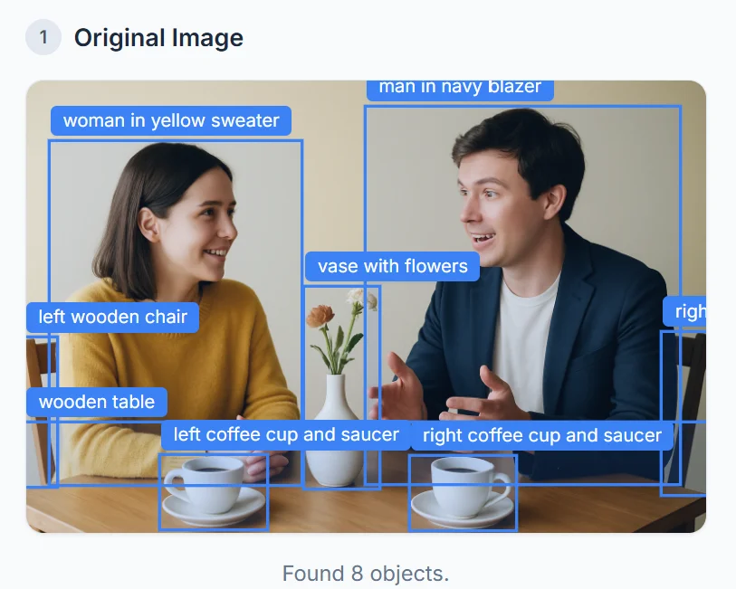<br><sub><b>物体検出</b>：VLM が8つの物体を見つけ、ラベルと枠を付けます。</sub></td>
    <td width="50%">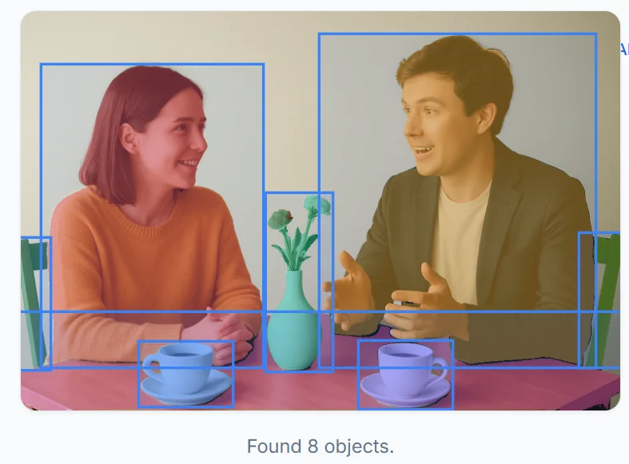<br><sub><b>切り分け</b>：SAM 2.1（ブラウザ内で実行）が、枠を手がかりに各物体の見えている画素を切り分けます。両端の椅子は、背もたれの細い部分だけが見えています。</sub></td>
  </tr>
  <tr>
    <td width="50%"><br><sub><b>切り出し</b>：物体ごとに写真から切り出します。</sub></td>
    <td width="50%">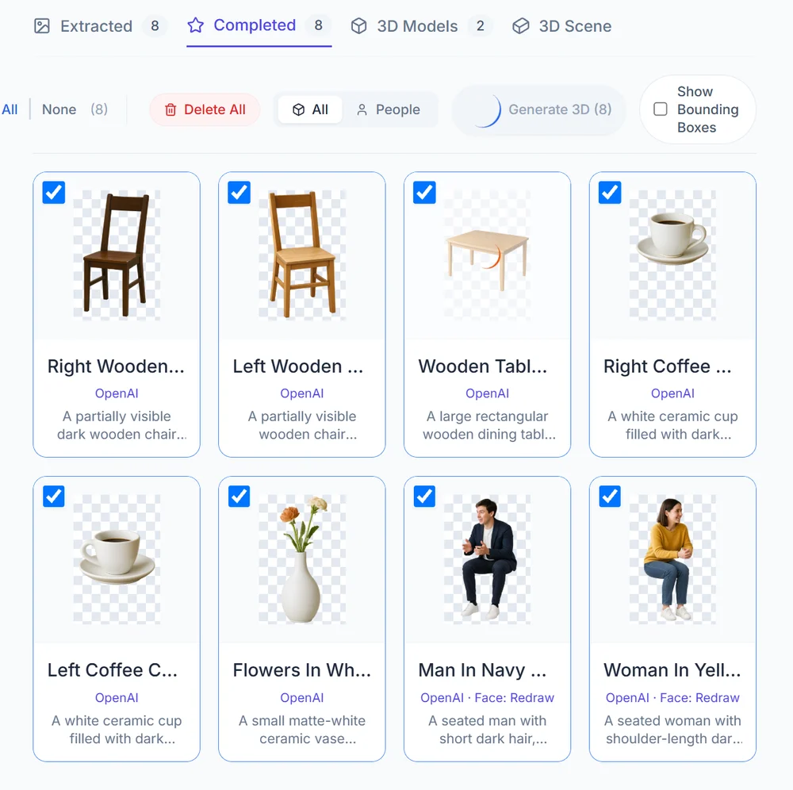<br><sub><b>画像補完</b>：隠れた部分を透明背景で描き足します。見えていた部分は元の位置に保たれる（緑の枠、「Part: kept」）ので、特徴点マッチングは要りません。</sub></td>
  </tr>
  <tr>
    <td width="50%"><br><sub><b>3D生成</b>：物体ごとにテクスチャ付きの3Dモデルを作ります（TRELLIS.2）。</sub></td>
    <td width="50%">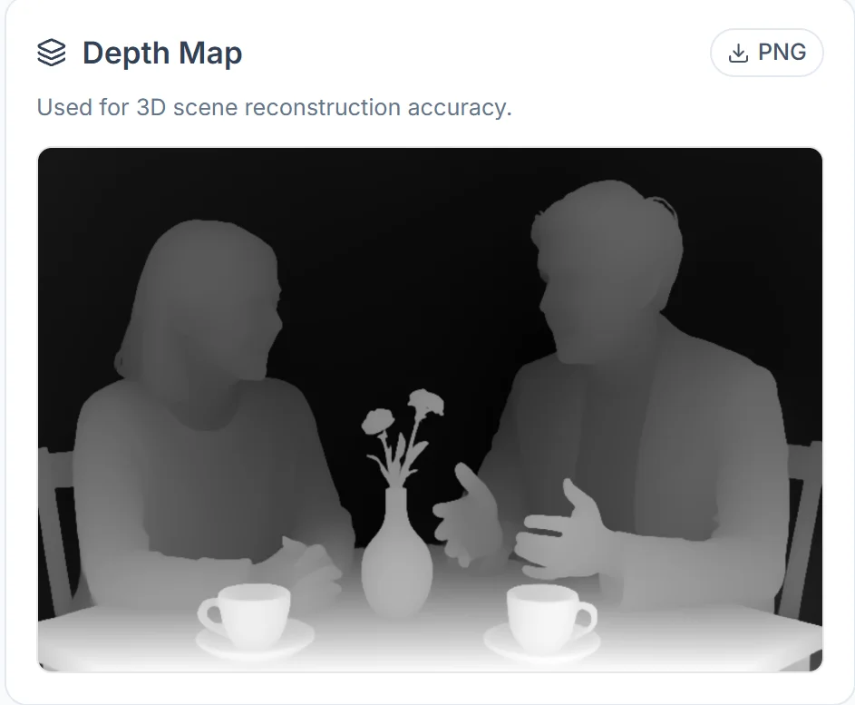<br><sub><b>深度推定</b>：Depth Anything V2 による深度マップです（明るいほど手前）。</sub></td>
  </tr>
  <tr>
    <td width="50%">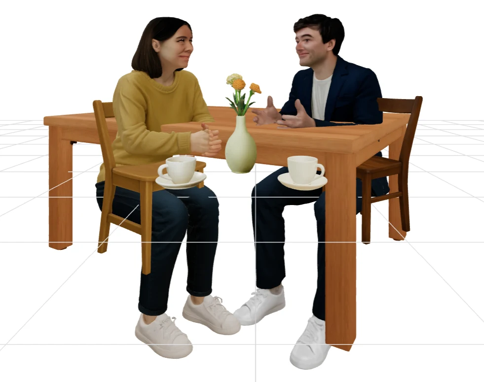<br><sub><b>シーン合成</b>：8つの物体を、遠近を考慮してそれぞれの PC Box の奥行きに置きます。背もたれしか見えない椅子も人物の後ろに置かれますが、天板の手前しか見えないテーブルの位置はまだおおよそです。</sub></td>
    <td width="50%">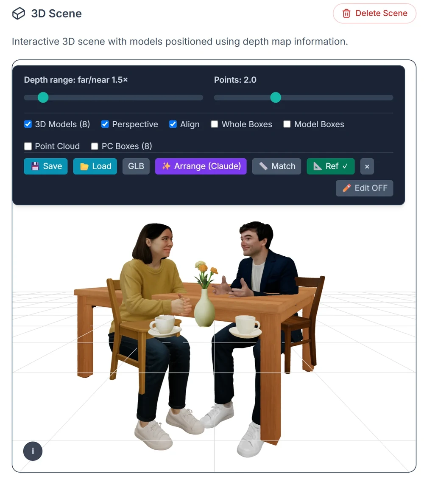<br><sub><b>3D Scene タブ</b>：シーンと操作パネルです。深度の範囲、点の大きさ、<b>Perspective</b>、<b>Align</b>（向き合わせ）、各種の枠と点群の表示、配置の <b>Save</b> / <b>Load</b>、<b>GLB</b> の書き出し、<b>✨ Arrange</b>（AI による意味を考えた配置替え）、<b>Match</b>（写真との一致度）、<b>Ref</b>（評価用の正解の解析）、モデルを手で動かす <b>Edit</b> があります。</sub></td>
  </tr>
  <tr>
    <td width="50%">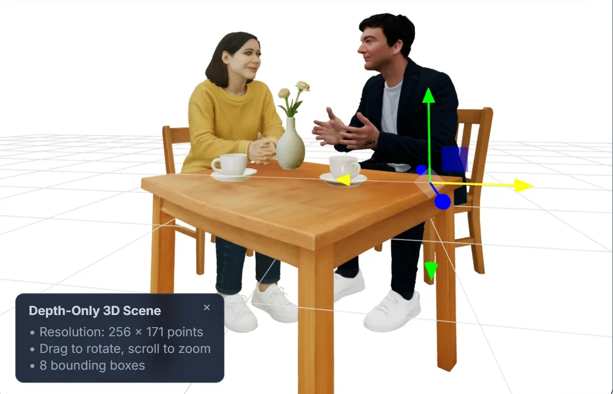<br><sub><b>手で編集した結果</b>：サンプルのテーブルと椅子の位置と大きさを、編集モード（<b>Edit ON</b>）の移動（Move）と拡大縮小（Scale）で直し、上から見たところです。カップと花瓶がテーブルに載り、2人が椅子に座っています。</sub></td>
    <td width="50%"></td>
  </tr>
</table>

## AI による意味を考えた配置替え（Arrange）

自動の配置では、物体ごとに推定した深度に、1つずつモデルを置きます。そのため視線方向の距離と大きさはおおまかで、物体どうしの関係がよく崩れます。カップがテーブルから浮いたり天板にめり込んだりし、人物が椅子に座らず、テーブルが実際の半分の高さになったりします。**Arrange** では、画像を読める AI が2段階でシーンを直し、写真とも、写っている物どうしの関係とも矛盾しないようにします。

### 2段階：まず写真を理解し、それから配置する

1. **元の写真の意味の解析。** AI は3Dシーンを見る前に、ツール（`report_scene`）で写真を記述します。
   - どんなシーンか。
   - 物体ごとの現実の高さと幅、大きさの基準になる物体（例：座った大人、標準的な机）。
   - 物体どうしの関係：「上に載る」（その接触が写真で見えるかどうかも）、「座る」、「向かって座る」、「向く」、「手前にある」。
2. **解析を計画にした、数回に分けた配置。** AI は毎回、次のものを見ます。
   - 写真と、シーンの3枚の描画（写真のカメラから、上から、斜め上から）。
   - 測った値の付いた物体の一覧。
   
   そして `update_placements` で、複数の物体の変更をまとめて出します。変更には `scale`、`scale_axes`、`rotate_y_deg`、`along_ray`、`rest_on` / `drop_on`、`place_under` があり、写真のカメラと床も設定できます。アプリは毎回、新しいシーンを測って AI に返します。
   - **写真との一致度**：写真のカメラから見た各モデルの見えている部分と、写真の物体マスクの IoU。
   - **物理的な検査**（メッシュで測る）：浮き、めり込み、ほかのモデルの中に入っている。
   - **関係の検査**（AI 自身の解析に照らす）：載っていない、人物がテーブルの輪郭の中にいる、大きさが現実から離れている、正面合わせで測った向きから回っている。
   
   AI は `finish` で終え、変えたことと写真とまだ違う点をまとめます。

ツールは、各物体の写真での位置を保ちます。`along_ray` は距離と大きさを一緒に変えます。`rest_on` は物体を視線に沿って滑らせて台に載せるもので、写真で接触が見えるときに使います。脚が写真の下で切れているなど接触が隠れているときは、まっすぐ上下に動かす `drop_on` を使います。

### 写真に合わせた恣意的な指示はない

- **どの写真にも同じ指示。** 指示文にあるのは一般的な規則だけです：解析の使い方、支えと接触、座った人、現実の大きさ、カメラ、ツールと測定値の使い方。テスト写真の名前も、その物体や配置も書いていません。写真ごとの内容は、すべて AI 自身がその写真を解析した結果から来ます。
- **2枚で開発し、別の2枚で確かめた。** 2枚の写真（`cafe-couple`、`table-talk`）で開発しました。途中の版にはカフェのテーブルの人向けの規則が増えていたので、それを解析の段階に置き換えました。指示文の例はよくある状況（例：斜めに見えるテーブル）で、これらの写真を記述したものではありません。カメラの例は、このために書き直しました。そのうえで、開発に使っていない2枚（`office-desk`：人のいない机、`woman-at-desk`：L字型の机の人）で、同じ指示文を変えずに実行しました。
- **後からたどれる。** 実行ごとに指示文の版（指示文とツールのハッシュ。下の結果はすべて `d5d766f8`）とアプリの版を記録します。
- **正解は AI に見せない。** 評価に使う正解の解析は、AI に見せません。

### そのほかの特徴

- **解析に基づく現実の大きさ。** AI は、解析で確かとした物体（人物、標準的な家具）から縮尺を決め、すべての物体を縦横同じ比率で拡大縮小して、現実の高さにします。
- **人物の体型は変えない。** 人物を1つの軸だけ伸ばす操作は受け付けず、縦横同じ比率でしか拡大縮小できません。どの物体についても、生成モデルからの縦横比の変化を記録します。
- **必要なときは写真のカメラも推定する。** シーンは水平・画角 60° のカメラを仮定しています。実寸と写真での位置が両立しないときは、AI がカメラの下向きの傾きと画角を設定できます。そのときモデルは、写真での位置と見かけの大きさを保ちます。下の実行で AI がこれを使ったのは1回（`table-talk`、8°）だけです。
- **一番良い状態を残す。** 最後の回でシーンが悪くなったときは、一番良かった回に戻します。判断には、写真との一致度から物理的な問題と関係の問題を引いた値を使います。
- **複数の AI で同じ方法。** Claude、OpenAI、Gemini が、同じ指示文とツールで動きます。
- **評価に必要なものをすべて記録。** テキストの報告、物体ごと・回ごとの CSV（時間、トークン数、費用、変更）、各回に AI が見た画像を並べた1枚の画像を保存します。

### 人が確かめた正解の解析による評価

写真ごとに、関係、接触の見え方、現実の大きさを人が確かめた正解の解析を用意しました（`samples/*.analysis.json`）。正解は、AI の下書きについての質問（正しい・間違い・分からない、と修正）に答えて作ります。不確かな関係は残しますが、採点しません。**📐 Ref** で読み込むと、実行を2つの面で評価します。

- **関係の問題**：正解の関係と大きさのうち、シーンが満たしていないもの。
- **AI 自身の解析**：関係の再現率と適合率、接触の見え方の判断、現実の高さの誤差。

### 結果

Claude（`claude-opus-5-5`、effort high、最大6回、指示文 `d5d766f8`）の最終の実行のうち、最も良いもの。矢印の前は自動の配置の値です。

| 写真 | 開発に使用 | 写真との一致度（IoU の平均） | 写真での面積で重み付け | 物理的な問題 | 関係の問題（正解に照らす） | 解析が見つけた関係 | 時間 / 費用 |
|---|---|---|---|---|---|---|---|
| cafe-couple | 使用 | 0.376 → **0.678** | 0.374 → **0.714** | 6 → **0** | — ¹ | 13/14 | 113秒 / 0.64ドル |
| table-talk | 使用 | 0.274 → **0.509** | 0.263 → **0.637** | 7 → **0** | 13 → 1 | 19/22 | 195秒 / 0.76ドル |
| office-desk | **不使用** | 0.425 → 0.437 | 0.648 → 0.653 | 5 → **0** | 1 → **0** | 11/11 | 98秒 / 0.65ドル |
| woman-at-desk | **不使用** | 0.294 → **0.405** | 0.382 → **0.583** | 8 → **0** | 5 → 1 ² | 13/13 | 148秒 / 0.96ドル |

¹ この実行では、正解の解析が別の物体と対応づけられたため数えていません。この不具合は直してあり、解析は手で数えました。
² 残った1件は誤検出です。L字型の机の内側の角に座る女性を、机の外形（長方形）による検査が「机の中にいる」と数えます。

- **物理的な問題は、すべての写真で 0 になりました。** 開発に使っていない2枚では、解析が正解の関係をすべて見つけました。
- **重み付きの一致度は、各物体を写真での面積で重み付けします。** 平均では、端に細く写るだけの物（椅子）や他の物に隠れた物が、人物と同じ重みになってしまうためです。`office-desk` は最初から写真とよく合っていたので、変化は小さくなりました。
- **`table-talk` では、解析が写真どおりです。** 2人はテーブルの角をはさんで座っていると読みました。AI は、正面合わせで測ったとおりテーブルを斜めのまま保ち、角を2人の間に置きました。この実行では生成されたテーブルの幅が約 4 m ありましたが、AI が実寸に縮めました。

<table>
  <tr>
    <td width="33%">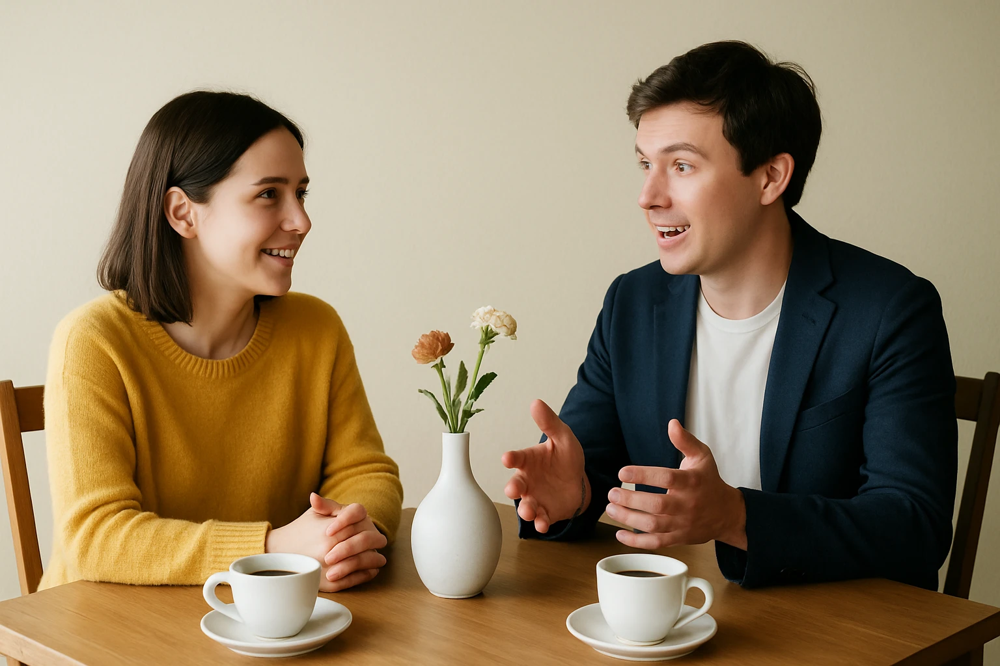<br><sub><b>写真</b> — 2人はテーブルの角をはさんで座っている。</sub></td>
    <td width="33%">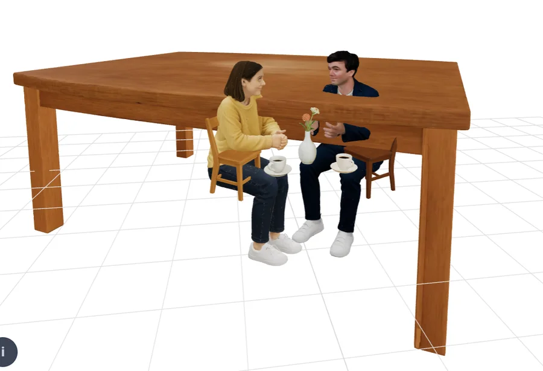<br><sub><b>Arrange の前</b> — 自動の配置。生成されたテーブルは幅約 4 m で人物の後ろにあり、カップと椅子が浮いている。</sub></td>
    <td width="33%">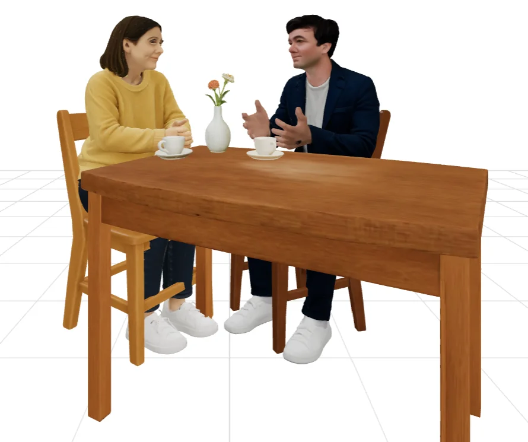<br><sub><b>Arrange の後（Claude）</b> — テーブルを実寸にして人物の手前に置き、斜めの向きを保った。カップと花瓶は天板の上、人物はそれぞれ椅子に座る。物理的な問題 7 → 0。</sub></td>
  </tr>
</table>

同じ4つのシーン（同じモデル、同じ配置から開始）での Claude と OpenAI（`gpt-5.6-sol`）：

| | Claude | OpenAI |
|---|---|---|
| 写真との一致度（4枚の平均） | **0.507** | 0.480 |
| 重み付きの一致度（平均） | **0.647** | 0.614 |
| 物理的な問題が 0 になった回 | **4/4** | 3/4 |
| 解析が見つけた関係 | 56/60 | 55/60 |
| 解析の現実の高さの誤差 | **2.9%** | 12.2% |
| 人物以外で1つの軸だけ伸ばした物体 | 3（低く生成されたテーブルと机） | 10（カップ、椅子、くずかご、ランプ。テーブルは平たく） |
| 調整の回数（平均） | **3.0** | 5.0 |

<table>
  <tr>
    <td width="50%"><br><sub><b>Claude</b> — 天板は生成モデルの形を保ち、テーブル全体を実寸に縮めた（一致度 0.509、重み付き 0.637）。</sub></td>
    <td width="50%">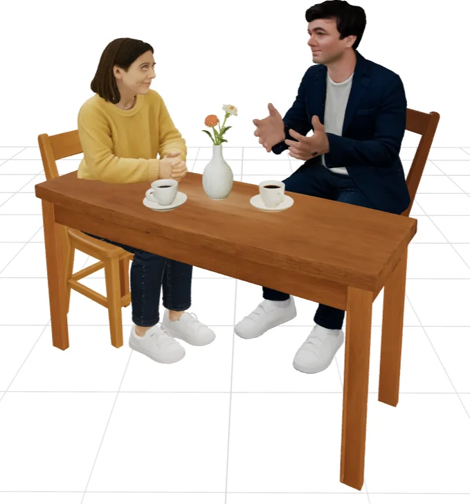<br><sub><b>OpenAI</b> — 同じシーン。一部が隠れた写真のテーブルの輪郭に合わせて奥行きを約3分の1に縮めた（幅は 0.8 倍）ため、細長くなった（一致度 0.575、重み付き 0.656）。</sub></td>
  </tr>
</table>

- **関係の理解：** 2つの AI はほぼ同じです。
- **現実の大きさ：** 差が出るのは、現実の大きさの見積もりと、物の形を保つかどうかです。OpenAI は1枚で、一部が隠れたテーブルの輪郭に合わせてテーブルを平たくし、一致度を上げました。`woman-at-desk` では一致度を下げました。
- **Gemini：** 開発に使った2枚での以前の実行で、遅く不安定でした（[docs/roadmap-jp.md](docs/roadmap-jp.md) を参照）。

### 実行で見えた限界

- **生成モデルの形と姿勢が上限を決めます。** 配置では直せません。
  - 写真では前かがみの人物が、まっすぐに生成される。
  - 腕を広げた身振りの人物。
  - L字型の机の奥の部分が細く生成される（写真ではその奥行きが見えない）。
- **関係の検査は外接箱を使います。** L字型の机のような凹んだ形の家具は表せません。
- **解析が見落とす関係の多くは、小さい物どうしの前後関係です**（花瓶とカップ）。

<table>
  <tr>
    <td width="50%">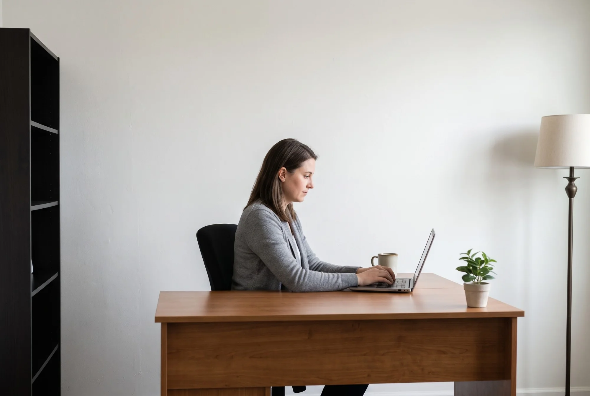<br><sub><b>写真</b>（開発に不使用）— L字型の机の内側の角に座る女性。</sub></td>
    <td width="50%">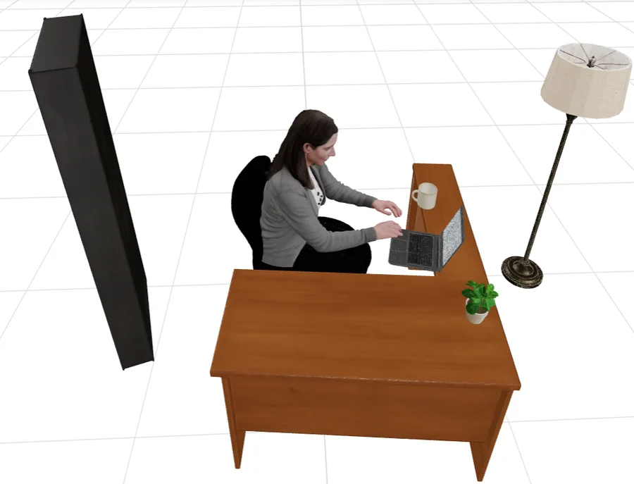<br><sub><b>Arrange の後（Claude）</b> — 女性は L字の角に座り、机の上の物は天板に、棚とランプは床に立つ（物理的な問題 8 → 0）。机の奥の部分は細く生成された（写真ではその奥行きが見えない）。</sub></td>
  </tr>
</table>


## 必要な環境

- Node.js 18以上
- **OpenAI または Google Gemini の APIキー**（物体検出と画像補完で別々のプロバイダーを使う場合は両方）
- 任意：3Dシーンの **Arrange**（意味を考えた配置替え）を使う場合は、Claude（既定）なら **Anthropic の APIキー**。AI Settings で OpenAI か Gemini を選べば、それぞれの APIキーで動く
- **Hugging Face トークン**（TRELLIS.2 / Hunyuan3D-2.1 による3D生成では必須。背景除去と深度推定でも推奨。ZeroGPUの利用分が各自の枠で計上されます）。Hugging Face の **Settings → Access Tokens** で **Read** のトークンを作り、アプリの画面右上の **HF Token** 欄に入力します。詳しくは [docs/hugging-face-spaces-jp.md](docs/hugging-face-spaces-jp.md) を参照してください

## セットアップ

```bash
git clone https://github.com/IWATSUKI-Masami/one-image-to-3d-scene.git
```

```bash
cd one-image-to-3d-scene
```

```bash
npm install
```

APIキーは画面上で入力するか、`.env.local` に書きます（`.env.example` をコピーしてください）。

```bash
cp .env.example .env.local
```

```bash
npm run dev
```

ブラウザで `http://localhost:3000` を開きます。

> [!WARNING]
> `VITE_` で始まる環境変数は、ビルド時に**JavaScriptにそのまま埋め込まれます**。また、APIはブラウザから直接呼び出されます。手元で動かす分には問題ありませんが、**キーを含んだビルドを公開サーバーにデプロイしないでください**。誰でもキーを読めてしまいます。公開する場合は `.env.local` を空にし、利用者それぞれが画面でキーを入力する形にしてください。

## AIプロバイダーとモデル

**AI Settings** はアプリの設定画面です。画面右上、HF Token の入力欄の左隣にある丸いボタンから開きます。ボタンの表示は、API キーが未設定のときは **Set API Keys**（灰色）、設定済みのときは **AI: Gemini / Gemini** のように使っているプロバイダー名（緑色）になります。API キーが必要な処理をキーなしで始めた場合も、自動で開きます。

AI Settings では次の項目を設定できます。

| 項目 | 内容 |
|---|---|
| Object detection & checks | 物体検出・チェックに使う AI（OpenAI / Gemini。既定は OpenAI） |
| Arrange (3D scene) | Arrange に使う AI（Claude / OpenAI / Gemini。既定は Claude。OpenAI と Gemini は物体検出のモデルを使う）と、1回の実行での最大回数（既定は6） |
| Image completion | 画像補完に使う AI（OpenAI / Gemini。既定は OpenAI） |
| Background removal | 背景除去のモデル（RMBG 2.0 / RMBG 3.0。既定は RMBG 2.0）。Gemini で補完するときだけ使い、OpenAI を選んでいる間は選択できない |
| API keys | OpenAI、Gemini、（Arrange 用の）Anthropic の API キー |
| Models | 使うモデルの ID |
| Hugging Face Spaces | 背景除去・深度推定・3D 生成で使う Space の ID（複製した Space など） |

既定のモデルは次のとおりです。

| 処理 | プロバイダー | 既定のモデル |
|---|---|---|
| 物体検出、キャンバス拡張量の推定、補完結果のチェック | OpenAI / Gemini | `gpt-5.6-sol` / `gemini-pro-latest` |
| 画像補完（アウトペインティング） | OpenAI / Gemini | `gpt-image-2.6-sunburst` / `gemini-3-pro-image` |
| 3Dシーンの Arrange（任意） | Anthropic / OpenAI / Gemini | `claude-opus-5-5` / 上の物体検出のモデル |

- OpenAI は補完画像を透明背景で返します。Gemini は透明背景を出力できないため、補完後に背景除去を行います。背景除去に失敗した場合は、補完画像のカードに表示されます。
- 物体検出と画像補完の既定は、どちらも OpenAI です。
- 背景除去には **BRIA RMBG 2.0**（既定）または **BRIA RMBG 3.0** を使います。AI Settings の **Background removal** で選べます。OpenAI で補完している間は背景除去を使わないので、選択できなくなります。どちらの Space も API は同じです。RMBG 2.0 はずっと軽く、複製すれば T4 で動きます。
- モデルIDは頻繁に変わります。モデルが提供終了になった場合は、AI Settings で新しいIDを入力してください。コードの変更は不要です。
- 論文の結果は `gemini-3-pro-preview` と `gemini-3-pro-image-preview`（どちらも提供終了）で得たものです。他のプロバイダーやモデルでも同じプロンプトを使いますが、検出精度や姿勢の保持には差が出る可能性があります。
- APIキーはメモリ上にだけ保持します。プロバイダーとモデルIDはブラウザに記憶されます。

### Hugging Face Spaces

背景除去、深度推定、3D生成では、次の Space を呼び出します。AI Settings の **Hugging Face Spaces** で変更できます。

| 処理 | 既定の Space |
|---|---|
| 背景除去（RMBG 3.0 / 2.0） | `briaai/BRIA-RMBG-3.0`、`briaai/BRIA-RMBG-2.0` |
| 深度推定 | `depth-anything/Depth-Anything-V2` |
| 3D生成 | `microsoft/TRELLIS.2`、`tencent/Hunyuan3D-2.1` |

公式の Space は ZeroGPU で動いており、利用者ごとに1日の利用枠があります（Hugging Face PRO では枠が大きくなります）。多数の物体を処理する場合は、Space を自分のアカウントに複製し（Space のページの **Duplicate this Space**）、専用 GPU を割り当てて、その ID を入力してください。専用 GPU は時間課金なので、使い終わったら Space を一時停止してください。

**手順の詳細**（トークン、モデルの利用規約への同意、シークレット `HF_TOKEN`、Hunyuan3D-2.1 の複製に必要な修正、よくあるエラー）は [docs/hugging-face-spaces-jp.md](docs/hugging-face-spaces-jp.md) にまとめています。

- **TRELLIS.2**：**A100**（80GB）を使ってください。TRELLIS.2 の開発元は 24GB 以上を必要とし、動作確認は A100/H100 だけです。また、Space は特定の GPU 向けにビルド済みの CUDA 拡張機能を読み込むため（今の公式 Space は ZeroGPU の GPU 向け）、それより小さい GPU や種類の違う GPU では動かないことがあります。
- **Hunyuan3D-2.1**：**A100**（80GB）を使ってください。形状とテクスチャの生成に約 29GB が必要で、Space は CUDA 拡張機能を A100/A10G 系の GPU 向けにビルドします。公式の Space は ZeroGPU 用なので、複製した場合はいくつかのファイルの修正（Python 3.10、Gradio 5.33.0、torch の固定、bpy の除去、`custom_rasterizer` のソースからのコンパイル、`zero.startup()` の無効化）が必要です。上の手順の詳細を参照してください。
- **深度推定**：T4 で十分です。
- **背景除去**：BRIA RMBG 3.0 は約 25GB（bf16 の重み）の4ステップの拡散モデルなので、**L40S** など 48GB の GPU が必要です。T4 や 24GB の GPU ではメモリが不足します。T4 を使う場合は、RMBG 2.0 を選び、`briaai/BRIA-RMBG-2.0` を複製してください。なお、RMBG 3.0 のモデルはゲート付きです。`briaai/RMBG-3.0` と `briaai/Fibo-2.0-edit-turbo` の利用規約に同意し、HF トークンを Space のシークレット `HF_TOKEN` として登録してください。
- **OpenAI で補完する場合**は背景がすでに透明なので、背景除去の Space はまったく不要です。
- BRIA RMBG のモデルは非商用利用（CC BY-NC 4.0）として公開されています。それ以外の用途では、モデルカードを確認してください。非公開の Space には、読み取り権限のある HF トークンが必要です。

## 使い方

1. **Detect & Crop**：画像をアップロードしてシーンを解析します。検出された物体は自動で切り出されます。
   - **注釈**：補完の前に、各物体のラベルと説明文をカードで編集できます（鉛筆のアイコン）。説明文は補完の指示に使われるので、隠れた部分の誤った推測を直せます（例：「長方形の机」を「L字型の机。右側が奥へ伸びている」に直す）。**EN / 日本語** で、カードの表示を英語と日本語で切り替えられます。日本語は VLM で翻訳し、日本語で編集した内容は英語に翻訳して指示に使います。
   - **物体マスク**（物体検出の直後に自動で実行。進み具合は写真の上の **Segment Objects** ボタンに表示）：検出した各物体の見えている画素を、その枠をプロンプトにして [SAM 2.1](https://huggingface.co/onnx-community/sam2.1-hiera-small-ONNX) で切り分けます。ブラウザ内で動き（transformers.js。WebGPU があれば使い、なければ WebAssembly）、API キーやトークンは不要です。モデル（約 70〜90 MB）は初回に Hugging Face からダウンロードされ、ブラウザにキャッシュされます。マスクは写真に重ねて表示され（**Masks** チェックボックス）、プロジェクトに保存されます。各物体の奥行き（式(4)）には、補完画像の透明度の代わりにこのマスクを使います。補完で物体の画素だけを描いて固定するのにも使います（手順2）。切り分けの途中で補完を始めた場合は、マスクができるのを待ってから補完します。**Segment Again** で切り分け直せます（失敗した場合や、マスクのないプロジェクトを読み込んだ場合など）。
2. **Image Completion**：切り出した物体を補完します（人物は全身、物体は欠けた部分）。補完後に背景が除去されます。まず VLM が、写真全体を見て、各物体が枠の外へ各方向にどこまで続いているかを推定します。切り出し画像は、画像生成AIの出力と同じ大きさのキャンバスに、隠れた部分の余白を取って置かれます。物体マスクを使って物体の画素だけを描き、OpenAI では編集マスクでその部分を変更不可にします。見えていた部分が位置を保てば（枠の近くを相関で探して確認。生成AIによる小さなずれや大きさの変化も補正）、補完画像の中でのその枠が、特徴点マッチングなしで分かります（カードの表示「Part: kept」）。保てなかった場合は AKAZE マッチングを使います（「Part: matched」）。補完の結果は、切れている部分や不自然な比率（脚が短いなど）がないかを確認し、あれば最大2回までキャンバスを広げてやり直します。見えていた部分の位置が保たれなかった場合は同じキャンバスでやり直し、最大3回のうち最もよい結果を使います。また、物体を赤い枠で示した写真全体を、見た目と向きの参考として生成AIに渡します。**Face** で人物の顔の描き方を選べます。**Calm**（既定。顔をくっきり描き、口を閉じた穏やかな表情にする。開いた口や歯は3Dで不気味に見えやすいため）、**Redraw**（顔をくっきり描き、表情はそのまま）、**Mannequin**（目鼻を描かないマネキン風）、**As in photo**（写真のまま）です。Completed のカードには、補完に使ったサービスと顔の描き方（例：「OpenAI · Face: Calm」）が表示されます。人物の3Dモデルは、オプションによらず高い解像度で生成します。
3. **3D Generation**：補完した画像から3Dモデルを生成します。3D生成モデルは、補完画像の視点を保つとは限りません（斜めから見た椅子が別の向きで作られるなど）。そこで、生成したモデルを縦軸まわりの各角度で描画して補完画像と比べ（シルエットの重なり、縦横比、明暗）、最もよく一致する角度だけモデルを回して、正面の姿を補完画像に合わせます（向き合わせ）。モデルのカードの表示、見えていた部分の枠、3Dシーンのすべてでこの向きを使います。シーンの **Align** チェックボックスでオフにできます。
4. **3D Scene**：深度マップを生成し、組み立てられたシーンを表示します。位置はTransformControlsで調整でき、glTF/GLBで書き出せます。
   - **Perspective**（チェックボックス。既定でオン）：点群、PC Box、モデルを、原点に置いたピンホールカメラ（水平画角 60° と仮定）から3次元に戻します。深度マップは、Depth Anything V2 の出力どおり視差（距離の逆数）として読みます。Depth Anything V2 は画像ごとに出力を全範囲に引き伸ばすので、一番遠い点と一番近い点の距離の比は分かりません。Perspective がオンのときは、**Depth** スライダーでこの比（遠/近）を設定します（既定 1.5。サンプル写真で、カップと人物の頭の大きさの比が現実的になる値です。奥行きの大きい場面では大きくしてください）。物体は現実の大きさの比を保つので、カメラの近くのカップが奥の人物と同じくらいの大きさになることはありません。また、最初のカメラの位置（写真のカメラの位置）から見ると、写真と同じ見え方になります。**チェックを外すと、論文の配置を再現します**。論文の配置では、物体を画像上の大きさのまま置き、明るさを直線的に距離に対応させるので、カメラに近い物体ほど大きくなりすぎます。
処理の詳細はプロジェクトに保存され、ブラウザのコンソールを見なくても確認できます。補完のカードには試行回数が表示され（カーソルを重ねると各試行の確認結果と位置の一致度）、3Dモデルのカードには向き合わせの角度と一致度が表示されます。ヘッダーの **Stats** で、これらを補完した物体ごとに1行の CSV ファイルとして保存できます（画像の端に接している辺、マスクの被覆率、推定した隠れた部分の広がり、編集マスクの有無、見えていた部分の特定方法、試行回数、位置の一致度、向き合わせの角度・一致度・IoU、処理時間）。手持ちの写真で手法を評価するときに使えます。

プロジェクト（画像、深度マップ、モデル、3Dシーンで手で直した配置とシーンの設定・カメラ）は保存と読み込みができます。

### 費用：AI の使用量を抑えるには

自動での配置は正確さを優先しているため、API の呼び出し（OpenAI / Gemini のクレジット）と GPU の時間を使います。

| 手順 | 呼び出し |
|---|---|
| 物体検出 | 写真1枚につき VLM を1回 |
| 画像補完（物体ごと） | VLM を1回（物体が枠の外へどこまで続くか）。その後、1回の試行ごとに画像生成を1回（写真全体を2枚目の参考画像として渡す）と VLM による確認を1回。切れている部分がある、比率が不自然、見えていた部分が動いた場合は、最大3回まで試行を繰り返す。1つの物体で、画像生成が最大3回、VLM が最大4回になる。**Attempts: 1** にすると、画像生成1回と VLM 1回 |
| 3D生成（物体ごと） | Hugging Face の Space を1回（GPU の時間・ZeroGPU の利用枠。API のクレジットではない）。人物は高い解像度で生成する |
| 物体マスク（SAM 2.1）、向き合わせ、深度による配置 | ブラウザ内で実行（深度マップは写真1枚につき Space を1回）。API のクレジットは使わない |
| 3Dシーンの Arrange（任意、1回の実行ごと） | シーンの解析に1回（写真を送る）、配置に最大8回ほど、選んだ AI を呼ぶ。配置では毎回、写真と3枚の描画を送る（**Arrange** を押したときだけ） |

試行の繰り返しは、物体を自動で正しく配置するためのものです。**自動での配置の正確さにこだわらず、シーンを自分で調整するなら、必要な機能だけを使ってください。**

- **Complete** の隣の **Attempts** を **1 (fewest credits)** にする：各物体の補完を1回だけ行い、確認とやり直しをしない。
- 補完と3D生成は、必要な物体だけに行う（カードを選択する）。たとえば、一部しか写っていない椅子やテーブルは除く。
- 最初の結果を使う：カードに「Part: matched」や「Part: not found」と出ても補完し直さず、配置を手で直す。
- シーンを手で調整する：3Dシーンで **Edit ON** にしてモデルをクリックし、移動・回転・拡大縮小の操作で直す（**Reset** で自動の配置に戻せる）。拡大縮小（Scale）では、**Uniform**（既定でオン）にすると、どの軸のハンドルでも全軸を同じ倍率で拡大縮小する。オフにすると、その軸だけを拡大縮小する。**Undo** / **Redo**（Ctrl+Z / Ctrl+Y）で、移動・回転・拡大縮小・リセットを取り消し、やり直せる。シーンのパネルの **Save** で、配置（各モデルの位置・回転・大きさ、シーンの設定、カメラ）を小さな JSON ファイル（数KB）に保存できる（手で直したモデルがあれば `<写真名>_layout-edited_<日時>.json`、なければ `_layout_`）。モデル自体は含まないので、同じプロジェクトで **Load** から読み込む。手で直した配置は、深度の範囲を変えるなどでシーンを作り直しても保たれ、プロジェクトの保存（ヘッダーの **Save**）にも含まれる。配置ファイルは、同じプロジェクトの複数の配置を残したり、共有したりするのに使う。**GLB** は、配置したモデルを1つの GLB ファイルに書き出す（ほかの3Dソフト向け。すべてのモデルを含むので大きい）。
- AI に配置を直させる：シーンのパネルの **✨ Arrange**（**Perspective** をオンにしておく。AI Settings の **Arrange** で選んだ AI の API キーが必要。既定は Claude で、OpenAI や Gemini も選べる）。AI がまず写真を解析し（シーン、現実の大きさ、関係：上に載る、座る、向かって座る、向き合う、手前にある。ログに表示され、報告に保存される）、それを計画として（実寸と写真での位置が両立しないときは、写真のカメラの下向きの傾きと画角も設定できる。仮定は水平・60°で、モデルは写真での位置と見かけの大きさを保つ）、写真とシーンの描画を比べながら数回に分けて配置を直す。進み具合と経過時間は左下に表示される（**Cancel** で中止）。終わると、パネルが緑色（「Arrange finished」）になり、短い音が鳴る。ページが裏にあるときは、タブのタイトルにも印が付く。終わった後（失敗や **Cancel** の後も）、パネルから評価に必要なデータをすべて保存できる。**Log**：テキストの報告（AI、モデル、effort、指示文とアプリの版、API 待ちと手元の処理に分けた時間、API の各呼び出しの時間とトークン数、トークン数と Claude のモデルでの概算費用、各回に AI が出した変更と一致度・物理的な問題の数、物体ごとの実行前後の値、時刻付きのログ全体）。**CSV**：物体ごとの実行前後の一致度と警告（設定、時間、トークン数、費用付き）。**Rounds**：各回と API の各呼び出しの CSV。**Images**：写真と、各回に AI が見た3枚の描画を並べた1枚の PNG。実行時間は Processing Times パネルにも表示される。パネルを閉じてもログは消えず、**📋 Log** でもう一度表示できる。最後の実行の報告はプロジェクトにも保存される。ログの最後に、実行前後の**写真との一致度**（写真のカメラから見た各モデルの見えている部分と、写真の物体マスクの IoU の平均）が表示される。AI もこの値を使って、物体が写真の位置からずれないように確かめる。あわせて、実行前後の**物理的な問題**の数も表示される。床や下の面から浮いている、めり込んでいる、ほかのモデルの中に一部が入っている、のいずれかをメッシュで測ったもので、AI にも物体ごとの警告として渡される。さらに、**関係の問題**の数も表示される。解析した関係や現実の大きさのうち、シーンがまだ満たしていないもの（例：カップが天板に載っていない、人物がテーブルの輪郭の中にいる、人物の大きさから見てテーブルが低すぎる）で、これも AI に警告として渡される。AI どうしを共通の物差しで比べるには、**📐 Ref** で人が確かめた正解の解析（例：`samples/cafe-couple.analysis.json`）を読み込む。実行はそれにも照らして評価される（関係の問題と、AI 自身の解析が正解とどれだけ合うか）。AI には見せない。**📏 Match** で、今のシーンの写真との一致度を、いつでも写真に重ねた画像で表示できる（緑：モデルとマスクが重なる部分、赤：写真にだけある部分、青：シーンにだけある部分。物体ごとの IoU と物理的な問題の数付き）。画像は PNG で、値は CSV で保存でき、Arrange の前後の比較などを論文に使える。ファイル名で配置の状態が分かる：自動の配置は `_scene_` / `_layout_` / `_photo-match_`、手で直したものは `-edited`、Arrange の後は `-arranged-claude`（または `-openai`、`-gemini`）が付く（後から手で直した場合も含む。例：`table-talk_scene-arranged-claude_<日時>.json`）。プロジェクトと配置ファイルには、Arrange の各回の記録（AI、モデル、日時、回数、実行前後の一致度）も保存され、Match の CSV の先頭には配置の状態と AI が書かれる。**✨ Arrange** ボタンには、選んでいる AI の名前が表示される。結果は手で直した配置として扱われ、プロジェクトに保存される。編集モードの **Undo** で、1回の実行をまとめて取り消せる。
- 物体マスク、向き合わせ、3Dシーン自体はクレジットを使わないので、オンのままでよい。


## ディレクトリ構成

```
├── App.tsx                 # メインアプリ（UIと処理の流れ）
├── components/             # Reactコンポーネント（3Dビューア、カード、オーバーレイ）
├── services/
│   ├── aiService.ts        # 物体検出・補完・チェックのプロンプト
│   ├── segmentation.ts     # 写真上の物体マスク（ブラウザ内の SAM 2.1）
│   ├── frontAlignment.ts   # モデルの向きを補完画像に合わせる（描画して比べる）
│   ├── semanticArrange.ts  # Arrange：指示文、ツール、回ごとの処理
│   ├── sceneAnalysis.ts    # Arrange：写真の解析、関係の検査、正解との比較
│   ├── arrangeProviders.ts # Arrange：Claude / OpenAI / Gemini の接続
│   ├── arrangeReport.ts    # Arrange：報告と CSV
│   └── ai/                 # プロバイダー層（OpenAI / Gemini）と既定のモデル
├── utils.ts                # 切り出し、AKAZEマッチング、深度推定、3D生成API
├── types.ts                # 型定義
├── samples/                # サンプル画像と正解の解析（*.analysis.json）
└── docs/                   # Hugging Face Spaces の手順、開発の経緯、今後の拡張、README の画像とデモ動画
```

## 今後の拡張

3D生成への [Pixal3D](https://huggingface.co/TencentARC/Pixal3D)（ピクセル整合型の画像-to-3D）の追加と、[ComfyUI](https://www.comfy.org/) による手元の GPU での3D生成、模様の少ないごく一部しか写っていない物体（天板の手前の端しか見えないテーブルなど）の配置の改善、向き合わせでの対称に近い物体の前後の取り違えへの対処、カメラの画角と遠/近の距離の比の較正（遠近を考慮した配置は、今は画角 60° を仮定）、人物の顔の改善を予定しています。詳しくは [docs/roadmap-jp.md](docs/roadmap-jp.md) を参照してください。

## 引用

研究で利用される場合は、以下の論文を引用してください。同じ内容を [`CITATION.cff`](CITATION.cff) にも書いてあるので、GitHub のリポジトリのページの About 欄にある **Cite this repository** から、APA や BibTeX の形式でコピーできます。

岩月 正見, 渡邊 瑞輝, 「単眼画像からの深度ベース高精度3Dシーン復元 ―生成AIによるオブジェクトベースアプローチ―」, 信学技報, KBSE2025-61, pp.73–78, 2026年3月.

```bibtex
@techreport{iwatsuki2026oneimage3d,
  author      = {Iwatsuki, Masami and Watanabe, Mizuki},
  title       = {Depth-Based High-Precision {3D} Scene Reconstruction from a Single Monocular Image: Object-Based Approach Using Generative {AI}},
  institution = {The Institute of Electronics, Information and Communication Engineers},
  type        = {IEICE Technical Report},
  number      = {KBSE2025-61},
  pages       = {73--78},
  year        = {2026},
  month       = mar
}
```

## ライセンス

[MIT](LICENSE)

このリポジトリに含まれるのはアプリケーションのコードのみです。呼び出している外部のモデルやAPI（Gemini、OpenAI、TRELLIS.2、Hunyuan3D-2.1、Depth Anything V2、BRIA RMBG 3.0 / 2.0、SAM 2.1 など）には、それぞれのライセンスと利用規約が適用されます。特に商用で利用する場合は、事前に確認してください。

特に [Tencent Hunyuan 3D 2.1 Community License](https://github.com/Tencent-Hunyuan/Hunyuan3D-2.1/blob/main/LICENSE) は、EU、英国、韓国では適用されません。これらの地域では TRELLIS.2（MIT）を使ってください。

## 更新履歴

[CHANGELOG.md](CHANGELOG.md) を参照してください。公開前の開発は非公開のリポジトリで行いました。その経緯は [docs/development-history-jp.md](docs/development-history-jp.md) にまとめています。
