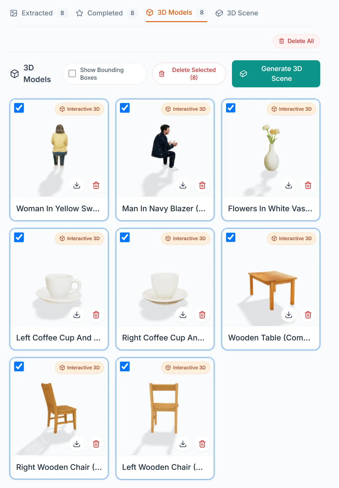

# One Image to 3D Scene

[English](README.md)

**単眼RGB画像1枚**から3Dシーンを復元するシステムです。

複数視点の画像や深度センサーから点群を復元する従来の方法とは異なり、本システムは**オブジェクトベース**のアプローチをとります。画像内の物体を一つずつ認識し、隠れている部分や画像の外にはみ出した部分を生成AIで補完し、物体ごとに3Dモデルを生成してから、単眼深度推定を使って3D空間に配置します。

[引用](#引用) に記載した論文の実装です。

<table>
  <tr>
    <td></td>
    <td></td>
  </tr>
  <tr>
    <td align="center">入力：1枚の写真</td>
    <td align="center">復元した3Dシーン</td>
  </tr>
</table>

サンプル画像 [`samples/two-people-at-table.webp`](samples/two-people-at-table.webp) は生成AIで作成したもので、論文でも入力として使っています。アプリを試す際にお使いください。

## 処理の流れ

| # | フェーズ | 手法 |
|---|---|---|
| 1 | 物体検出 | VLM（Gemini または OpenAI）でバウンディングボックス、ラベル、詳細な説明（姿勢・動作・服装）を取得 |
| 2 | 切り出し | HTML5 Canvas API |
| 3 | 画像補完 | 生成AI（Gemini または OpenAI の画像生成）によるアウトペインティングで、姿勢を保ったまま隠れた部分や切れた部分を復元し、背景を除去（BRIA RMBG 2.0） |
| 4 | 特徴点マッチング | AKAZE（OpenCV.js）、Lowe's Ratio Test、RANSAC による拡大率と移動量の推定（複数の縮小率で探索）で、元の切り出し画像が補完画像のどこにあたるかを特定（信頼できない場合は物体全体の枠を使用） |
| 5 | 深度推定 | Depth Anything V2。物体の深度はマスク内の深度の中央値 |
| 6 | 3D生成 | TRELLIS.2 または Hunyuan3D-2.1（Hugging Face Spaces）でテクスチャ付きGLBを生成 |
| 7 | シーン合成 | Three.js。深度マップから作った点群のバウンディングボックス（PC Box）にモデルを合わせて配置 |

### 処理の流れ（サンプル画像）

<table>
  <tr>
    <td width="50%"><br><sub><b>1. 物体検出</b>：VLM が8物体のラベルと枠を取得</sub></td>
    <td width="50%"><br><sub><b>2. 切り出し</b>：物体ごとに写真から切り出す</sub></td>
  </tr>
  <tr>
    <td width="50%"><br><sub><b>3. 画像補完</b>：隠れた部分を生成し、背景を除去</sub></td>
    <td width="50%"><br><sub><b>6. 3D生成</b>：物体ごとにテクスチャ付き3Dモデルを生成（TRELLIS.2）</sub></td>
  </tr>
  <tr>
    <td width="50%"><br><sub><b>5. 深度推定</b>：Depth Anything V2（明るいほど手前）</sub></td>
    <td width="50%"><br><sub><b>7. シーン合成</b>：各モデルを PC Box の奥行きに配置（人物、花瓶、カップ）</sub></td>
  </tr>
</table>

## 必要な環境

- Node.js 18以上
- **Google Gemini または OpenAI の APIキー**（物体検出と画像補完で別々のプロバイダーを使う場合は両方）
- **Hugging Face トークン**（TRELLIS.2 / Hunyuan3D-2.1 による3D生成では必須。背景除去と深度推定でも推奨。ZeroGPUの利用分が各自の枠で計上されます）

## セットアップ

```bash
git clone https://github.com/IWATSUKI-Masami/one-image-to-3d-scene.git
```

```bash
cd one-image-to-3d-scene
```

```bash
npm install
```

APIキーは画面上で入力するか、`.env.local` に書きます（`.env.example` をコピーしてください）。

```bash
cp .env.example .env.local
```

```bash
npm run dev
```

ブラウザで `http://localhost:3000` を開きます。

> [!WARNING]
> `VITE_` で始まる環境変数は、ビルド時に**JavaScriptにそのまま埋め込まれます**。また、APIはブラウザから直接呼び出されます。手元で動かす分には問題ありませんが、**キーを含んだビルドを公開サーバーにデプロイしないでください**。誰でもキーを読めてしまいます。公開する場合は `.env.local` を空にし、利用者それぞれが画面でキーを入力する形にしてください。

## AIプロバイダーとモデル

画面上部のAIボタンから **AI Settings** を開き、プロバイダーの選択、APIキーの入力、モデルIDの変更ができます。

| 処理 | プロバイダー | 既定のモデル |
|---|---|---|
| 物体検出、キャンバス拡張量の推定、補完結果のチェック | Gemini / OpenAI | `gemini-pro-latest` / `gpt-5.6-sol` |
| 画像補完（アウトペインティング） | Gemini / OpenAI | `gemini-3-pro-image` / `gpt-image-2.6-sunburst` |

- OpenAI は補完画像を透明背景で返します。Gemini は透明背景を出力できないため、補完後に背景除去（BRIA RMBG 2.0）を行います。背景除去に失敗した場合は、補完画像のカードに表示されます。
- モデルIDは頻繁に変わります。モデルが提供終了になった場合は、AI Settings で新しいIDを入力してください。コードの変更は不要です。
- 論文の結果は `gemini-3-pro-preview` と `gemini-3-pro-image-preview`（どちらも提供終了）で得たものです。他のプロバイダーやモデルでも同じプロンプトを使いますが、検出精度や姿勢の保持には差が出る可能性があります。
- APIキーはメモリ上にだけ保持します。プロバイダーとモデルIDはブラウザに記憶されます。

### Hugging Face Spaces

背景除去、深度推定、3D生成では、次の Space を呼び出します。AI Settings の **Hugging Face Spaces** で変更できます。

| 処理 | 既定の Space |
|---|---|
| 背景除去 | `briaai/BRIA-RMBG-2.0` |
| 深度推定 | `depth-anything/Depth-Anything-V2` |
| 3D生成 | `microsoft/TRELLIS.2`、`tencent/Hunyuan3D-2.1` |

公式の Space は ZeroGPU で動いており、利用者ごとに1日の利用枠があります（Hugging Face PRO では枠が大きくなります）。多数の物体を処理する場合は、Space を自分のアカウントに複製し（Space のページの **Duplicate this Space**）、専用 GPU を割り当てて、その ID を入力してください。専用 GPU は時間課金なので、使い終わったら Space を一時停止してください。

- **TRELLIS.2**：**A100**（80GB）を使ってください。TRELLIS.2 の開発元は 24GB 以上を必要とし、動作確認は A100/H100 だけです。また、Space は特定の GPU 向けにビルド済みの CUDA 拡張機能を読み込むため（今の公式 Space は ZeroGPU の GPU 向け）、それより小さい GPU や種類の違う GPU では動かないことがあります。
- **背景除去・深度推定**：T4 で十分です。非公開の Space には、読み取り権限のある HF トークンが必要です。

## 使い方

1. **Detect & Crop**：画像をアップロードしてシーンを解析します。検出された物体は自動で切り出されます。
2. **Image Completion**：切り出した物体を補完します（人物は全身、物体は欠けた部分）。補完後に背景が除去されます。
3. **3D Generation**：補完した画像から3Dモデルを生成します。
4. **3D Scene**：深度マップを生成し、組み立てられたシーンを表示します。位置はTransformControlsで調整でき、glTF/GLBで書き出せます。

プロジェクト（画像、深度マップ、モデル、配置）は保存と読み込みができます。

## ディレクトリ構成

```
├── App.tsx                 # メインアプリ（UIと処理の流れ）
├── components/             # Reactコンポーネント（3Dビューア、カード、オーバーレイ）
├── services/
│   ├── aiService.ts        # 物体検出・補完・チェックのプロンプト
│   └── ai/                 # プロバイダー層（Gemini / OpenAI）と既定のモデル
├── utils.ts                # 切り出し、AKAZEマッチング、深度推定、3D生成API
├── types.ts                # 型定義
├── samples/                # サンプル画像
└── docs/                   # 開発の経緯、今後の拡張、README の画像
```

## 今後の拡張

3D生成への [Pixal3D](https://huggingface.co/TencentARC/Pixal3D)（ピクセル整合型の画像-to-3D）の追加と、[ComfyUI](https://www.comfy.org/) による手元の GPU での3D生成、一部しか写っていない物体（テーブルの端や画像の端の椅子など）の配置の改善を予定しています。詳しくは [docs/roadmap-jp.md](docs/roadmap-jp.md) を参照してください。

## 引用

研究で利用される場合は、以下の論文を引用してください。

岩月 正見, 渡邊 瑞輝, 「単眼画像からの深度ベース高精度3Dシーン復元 ―生成AIによるオブジェクトベースアプローチ―」, 信学技報, KBSE2025-61, pp.73–78, 2026年3月.

```bibtex
@techreport{iwatsuki2026oneimage3d,
  author      = {Iwatsuki, Masami and Watanabe, Mizuki},
  title       = {Depth-Based High-Precision {3D} Scene Reconstruction from a Single Monocular Image: Object-Based Approach Using Generative {AI}},
  institution = {The Institute of Electronics, Information and Communication Engineers},
  type        = {IEICE Technical Report},
  number      = {KBSE2025-61},
  pages       = {73--78},
  year        = {2026},
  month       = mar
}
```

## ライセンス

[MIT](LICENSE)

このリポジトリに含まれるのはアプリケーションのコードのみです。呼び出している外部のモデルやAPI（Gemini、OpenAI、TRELLIS.2、Hunyuan3D-2.1、Depth Anything V2、BRIA RMBG 2.0 など）には、それぞれのライセンスと利用規約が適用されます。特に商用で利用する場合は、事前に確認してください。

特に [Tencent Hunyuan 3D 2.1 Community License](https://github.com/Tencent-Hunyuan/Hunyuan3D-2.1/blob/main/LICENSE) は、EU、英国、韓国では適用されません。これらの地域では TRELLIS.2（MIT）を使ってください。

## 更新履歴

[CHANGELOG.md](CHANGELOG.md) を参照してください。公開前の開発は非公開のリポジトリで行いました。その経緯は [docs/development-history-jp.md](docs/development-history-jp.md) にまとめています。
