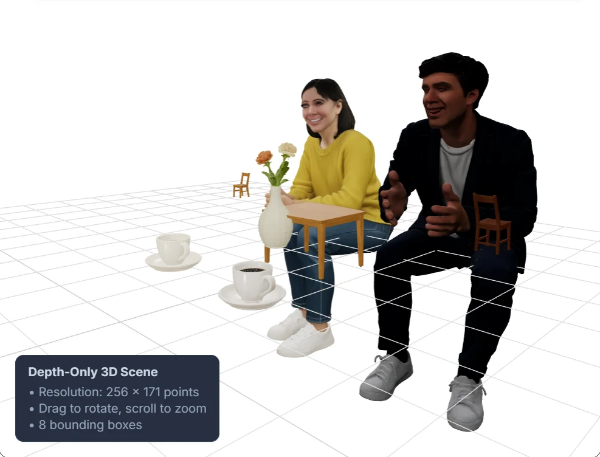
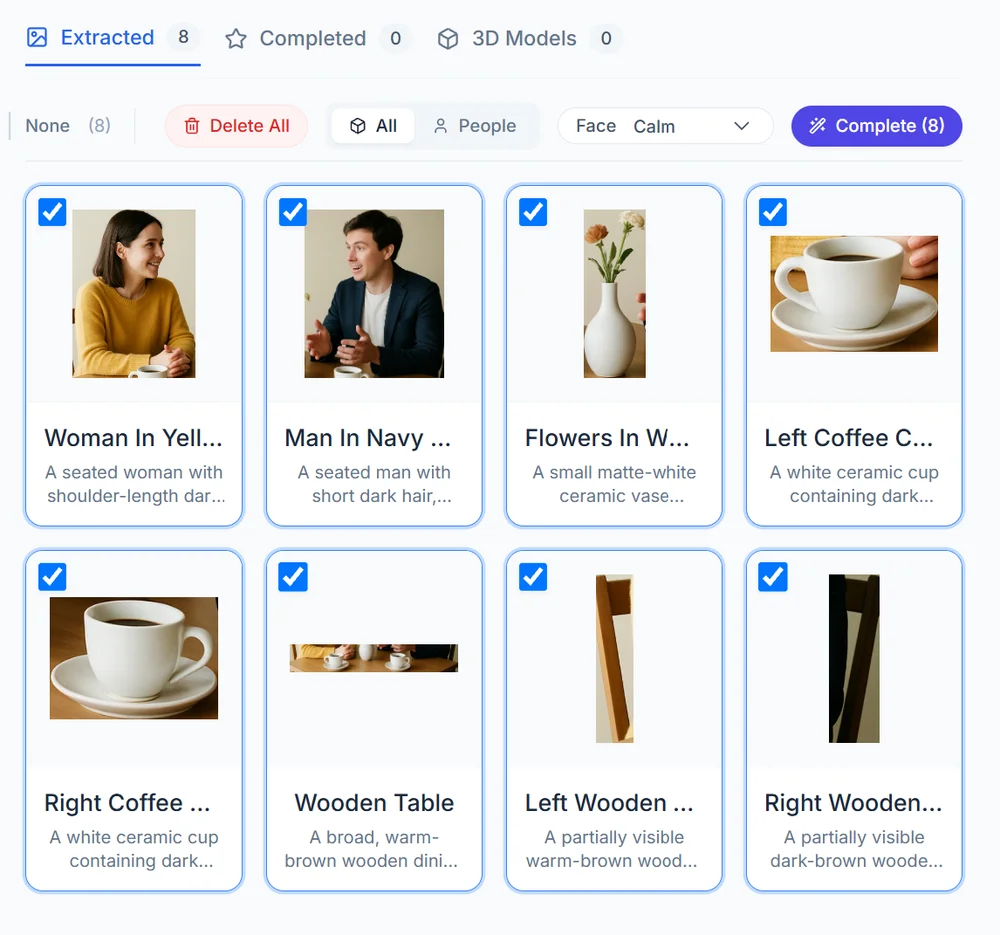
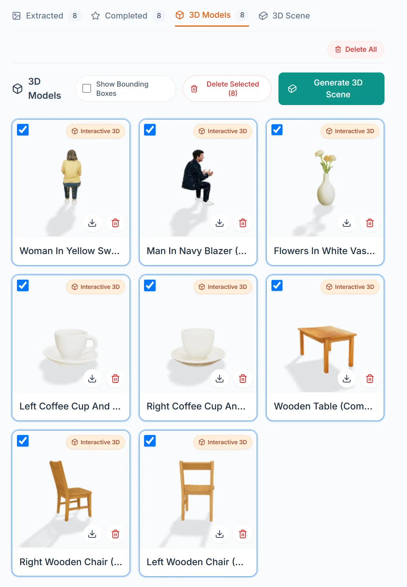
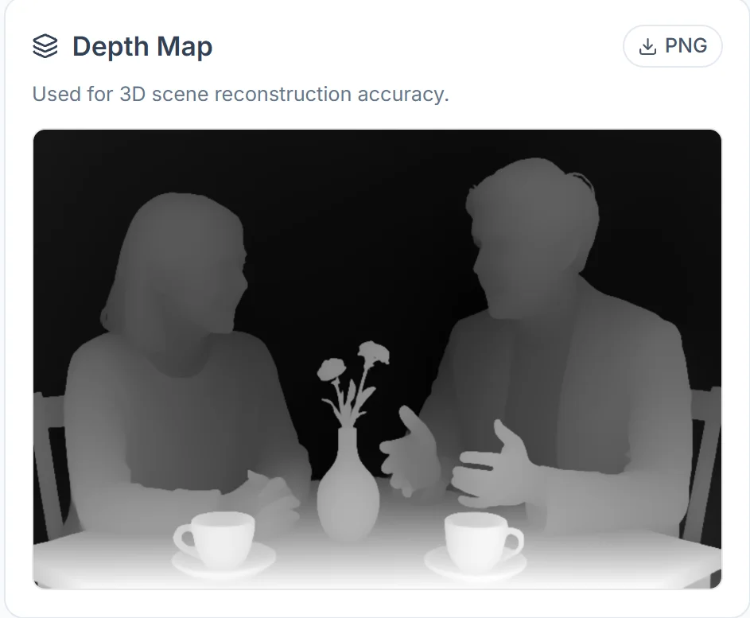
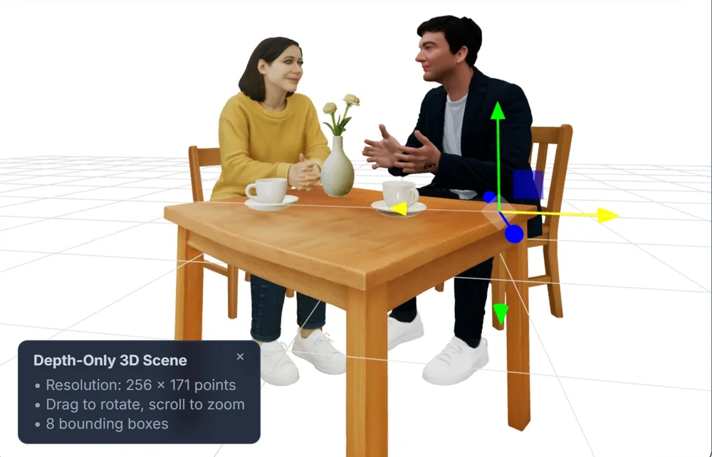

# One Image to 3D Scene

[日本語](README-jp.md)

Reconstruct a 3D scene from a **single monocular RGB image**.

Instead of reconstructing a point cloud from multiple views or a depth sensor, this system takes an **object-based** approach: it recognizes each object in the image, completes the parts that are hidden or cut off with generative AI, turns each object into a 3D model, and places the models in 3D space using monocular depth estimation.

This is the reference implementation of the paper listed in [Citation](#citation).

<table>
  <tr>
    <td></td>
    <td></td>
  </tr>
  <tr>
    <td align="center">Input: a single photo</td>
    <td align="center">Reconstructed 3D scene</td>
  </tr>
</table>

The sample photo [`samples/two-people-at-table.webp`](samples/two-people-at-table.webp) is AI-generated and is the input used in the paper. You can use it to try the app.

## Pipeline

| # | Phase | Method |
|---|---|---|
| 1 | Object detection | Vision-Language Model (OpenAI or Gemini) returns bounding boxes, labels and detailed descriptions (pose, action, clothing) |
| 2 | Cropping | HTML5 Canvas API |
| 3 | Image completion | Generative AI outpainting (OpenAI or Gemini image generation) restores occluded / cut-off parts while preserving pose. OpenAI returns a transparent background; Gemini completions go through background removal (BRIA RMBG 2.0 or 3.0) |
| 4 | Locating the visible part | The crop keeps a known box through completion (layout-preserving canvas, OpenAI edit mask), checked and corrected by correlation near that box; AKAZE (OpenCV.js) + Lowe's ratio test + RANSAC fit of a scale + translation is the fallback when the image model moved it |
| 5 | Depth estimation | Depth Anything V2; object depth is the median depth inside the object mask |
| 6 | 3D generation | TRELLIS.2 or Hunyuan3D-2.1 (Hugging Face Spaces) → textured GLB |
| 7 | Scene composition | Three.js; models are aligned to point-cloud bounding boxes (PC Box) built from the depth map. By default the boxes are back-projected with perspective (see Usage) |
| 8 | Front alignment | Each model is rendered around the vertical axis and compared with its completed image (silhouette, aspect ratio, brightness), then turned to match it and by the view angle, so it faces the camera as in the photo |

### Walkthrough (sample photo)

Results of the current version. Detection and completion use OpenAI (only the right chair in the completion image was completed with Gemini), 3D generation uses TRELLIS.2, and people were completed with the **Calm** face style. The scene uses perspective placement (far/near ratio 1.5) and front alignment, and each model is placed by the box of its visible part, kept through completion (the paper's box placement).

<table>
  <tr>
    <td width="50%"><br><sub><b>Detection</b> — the VLM finds 8 objects and gives each a label and a box.</sub></td>
    <td width="50%"><br><sub><b>Segmentation</b> — SAM 2.1, running in the browser, segments the visible pixels of each object from its box. Only thin strips of the chairs' backrests are visible at the borders.</sub></td>
  </tr>
  <tr>
    <td width="50%"><br><sub><b>Cropping</b> — each object is cut out of the photo.</sub></td>
    <td width="50%"><br><sub><b>Completion</b> — the hidden parts are drawn with a transparent background. The visible part stays in place (green box, "Part: kept"), so no feature matching is needed.</sub></td>
  </tr>
  <tr>
    <td width="50%"><br><sub><b>3D generation</b> — one textured 3D model per object (TRELLIS.2).</sub></td>
    <td width="50%"><br><sub><b>Depth estimation</b> — the depth map from Depth Anything V2 (brighter is nearer).</sub></td>
  </tr>
  <tr>
    <td width="50%"><br><sub><b>Scene composition</b> — the 8 objects are placed with perspective at the depth of their PC Boxes. The chairs, of which only the backrests are visible, stand behind the people; the table, visible only as the front of its top, is still placed only roughly.</sub></td>
    <td width="50%"><br><sub><b>3D Scene tab</b> — the scene and its controls: depth range, point size, <b>Perspective</b>, <b>Align</b> (front alignment), boxes and point cloud, <b>Save</b> / <b>Load</b> of the layout, and <b>Edit</b> for moving models by hand.</sub></td>
  </tr>
  <tr>
    <td width="50%"><br><sub><b>Edited by hand</b> — the table and chairs moved and resized in edit mode (<b>Edit ON</b>); the transform controls are visible.</sub></td>
    <td width="50%"></td>
  </tr>
</table>

## Requirements

- Node.js 18 or later
- **An API key for OpenAI or Google Gemini** (or both, if you use one for detection and the other for completion)
- **Hugging Face token** (required for 3D generation with TRELLIS.2 / Hunyuan3D-2.1; recommended for background removal and depth estimation, since ZeroGPU usage is counted against your own quota). Create a **Read** token in **Settings → Access Tokens** on Hugging Face and enter it in the **HF Token** field at the top right of the app; see [docs/hugging-face-spaces.md](docs/hugging-face-spaces.md)

## Setup

```bash
git clone https://github.com/IWATSUKI-Masami/one-image-to-3d-scene.git
```

```bash
cd one-image-to-3d-scene
```

```bash
npm install
```

API keys can be entered in the UI, or put in a `.env.local` file (copy `.env.example`):

```bash
cp .env.example .env.local
```

```bash
npm run dev
```

Open `http://localhost:3000` in your browser.

> [!WARNING]
> Variables prefixed with `VITE_` are **embedded into the JavaScript bundle** at build time, and API calls are made directly from the browser. This is fine for running the app locally. **Do not deploy a build that contains your keys to a public server** — anyone could read them. For a public deployment, leave `.env.local` empty and let each user enter their own keys in the UI.

## AI providers and models

**AI Settings** is the app's settings dialog. Open it with the round button at the top right of the screen, to the left of the HF Token field. The button reads **Set API Keys** (grey) until the API keys are set, and then shows the providers in use, e.g. **AI: Gemini / Gemini** (green). The dialog also opens automatically when you start a step that needs a missing key.

In AI Settings you can set:

| Section | What it sets |
|---|---|
| Object detection & checks | Provider for detection and checks (OpenAI / Gemini; default OpenAI) |
| Image completion | Provider for completion (OpenAI / Gemini; default OpenAI) |
| Background removal | Background-removal model (RMBG 2.0 / RMBG 3.0; default RMBG 2.0). Only used with Gemini completion; disabled when OpenAI is selected |
| API keys | OpenAI and Gemini API keys |
| Models | Model IDs |
| Hugging Face Spaces | Space IDs for background removal, depth estimation and 3D generation (e.g. your duplicated Spaces) |

Default models:

| Task | Providers | Default model |
|---|---|---|
| Object detection, canvas expansion estimate, completion check | OpenAI / Gemini | `gpt-5.6-sol` / `gemini-pro-latest` |
| Image completion (outpainting) | OpenAI / Gemini | `gpt-image-2.6-sunburst` / `gemini-3-pro-image` |

- OpenAI returns completions with a transparent background. Gemini cannot, so its completions go through background removal; a failed removal is marked on the completed card.
- OpenAI is the default for both detection and completion.
- Background removal uses **BRIA RMBG 2.0** (default) or **BRIA RMBG 3.0**, selected under **Background removal** in AI Settings. The choice is disabled while OpenAI does the completion, since it is not used then. Both Spaces have the same API; RMBG 2.0 is much lighter, so a duplicate of it runs on a T4.
- Model IDs change often. If a model is retired, type a new ID in AI Settings; no code change is needed.
- The results in the paper were obtained with `gemini-3-pro-preview` and `gemini-3-pro-image-preview` (both since shut down). Other providers and models use the same prompts, but detection accuracy and pose preservation may differ.
- API keys are kept in memory only. Providers and model IDs are remembered in the browser.

### Hugging Face Spaces

Background removal, depth estimation and 3D generation call these Spaces. They can be changed under **Hugging Face Spaces** in AI Settings.

| Task | Default Space |
|---|---|
| Background removal (RMBG 3.0 / 2.0) | `briaai/BRIA-RMBG-3.0`, `briaai/BRIA-RMBG-2.0` |
| Depth estimation | `depth-anything/Depth-Anything-V2` |
| 3D generation | `microsoft/TRELLIS.2`, `tencent/Hunyuan3D-2.1` |

The official Spaces run on ZeroGPU, which has a daily quota per user (larger with Hugging Face PRO). To process many objects, duplicate a Space to your account (**Duplicate this Space** on its page), give it a dedicated GPU, and enter its ID. Dedicated GPUs are billed per hour — pause the Space when you are done.

**Step-by-step guide** (tokens, accepting model terms, the `HF_TOKEN` secret, the changes a Hunyuan3D-2.1 duplicate needs, and common errors): [docs/hugging-face-spaces.md](docs/hugging-face-spaces.md)

- **TRELLIS.2**: use an **A100** (80 GB). The TRELLIS.2 authors require at least 24 GB and verified only A100/H100, and the Space installs CUDA extensions prebuilt for specific GPUs (the current official Space targets the ZeroGPU hardware), so smaller or different GPUs may fail.
- **Hunyuan3D-2.1**: an **A100** (80 GB). Shape plus texture generation needs about 29 GB, and the Space builds its CUDA extensions for A100/A10G-class GPUs. The official Space is built for ZeroGPU, so a duplicate needs a few file changes (Python 3.10, Gradio 5.33.0, pinned torch, no `bpy`, `custom_rasterizer` compiled from source, no `zero.startup()`); see the guide.
- **Depth estimation**: a T4 is enough.
- **Background removal**: BRIA RMBG 3.0 is a 4-step diffusion model of about 25 GB (bf16 weights), so it needs a 48 GB GPU such as an **L40S**; a T4 or 24 GB GPU runs out of memory. To use a T4, select RMBG 2.0 and duplicate `briaai/BRIA-RMBG-2.0` instead. The RMBG 3.0 models are gated: accept the terms of `briaai/RMBG-3.0` and `briaai/Fibo-2.0-edit-turbo` and add your HF token as the Space secret `HF_TOKEN`.
- With **OpenAI completion** the background is already transparent, so no background-removal Space is needed at all.
- BRIA RMBG models are released for non-commercial use (CC BY-NC 4.0); check the model card before other uses. Private Spaces need an HF token with read access.

## Usage

1. **Detect & Crop** — upload an image and analyze the scene. Detected objects are cropped automatically.
   - **Segment Objects** (optional, above the photo) — segments the visible pixels of each detected object with [SAM 2.1](https://huggingface.co/onnx-community/sam2.1-hiera-small-ONNX), prompted with its box. It runs in the browser (transformers.js; WebGPU if available, otherwise WebAssembly) and needs no key or token; the model (about 70–90 MB) is downloaded from Hugging Face on first use and cached by the browser. The masks are shown over the photo (**Masks** checkbox), saved with the project, and used for the depth of each object (Eq. (4)) instead of the completed image's alpha. They also let the completion draw and lock only the object's pixels (step 2).
2. **Image Completion** — complete the cropped objects (full body for people, missing parts for objects). The background is removed after completion. The VLM first estimates, from the whole photo, how far each object extends beyond its box on each side; the crop is then placed on a canvas of the image model's output size with room for the hidden parts. If the photo was segmented (**Segment Objects**), only the object's pixels are drawn and, with OpenAI, an edit mask keeps them unchanged. When the visible part stays in place (checked by correlation near its box, which also corrects small shifts and size changes by the image model), its box in the completed image is known without feature matching (card caption "Part: kept"); otherwise AKAZE matching is used ("Part: matched"). Each completion is checked for cut-off parts and unnatural proportions (e.g. shortened legs) and retried up to twice on a larger canvas; a completion whose visible part moved is retried on the same canvas (best of up to three attempts). The image model also receives the whole photo with the object marked by a red box, as a reference for its appearance and viewpoint. **Face** sets how faces of people are drawn: **Calm** (default; sharp face with a relaxed, closed-mouth expression, since open mouths and teeth look uncanny in 3D), **Redraw** (sharp face, same expression), **Mannequin** (smooth face without painted features) or **As in photo**. Each completed card shows the provider and face style used (e.g. "OpenAI · Face: Calm"). People are always generated in 3D at a higher resolution.
3. **3D Generation** — convert the completed images into 3D models. The generator does not always keep the viewpoint of the completed image (e.g. a chair seen obliquely may come back facing another way), so each model is then rendered at angles around the vertical axis and compared with its completed image (silhouette overlap, aspect ratio, brightness); the best angle turns the model so that its front view matches the image (front alignment). The card viewer, the visible-part box and the scene use it; the **Align** checkbox in the scene turns it off.
4. **3D Scene** — generate the depth map and view the assembled scene. Positions can be adjusted with the transform controls, and the scene can be exported as glTF/GLB.
   - **Perspective** (checkbox, on by default): the point cloud, the PC Boxes and the models are back-projected through a pinhole camera at the origin with an assumed 60° horizontal field of view, and the depth map is read as disparity (inverse depth), which is what Depth Anything V2 outputs. Depth Anything V2 stretches its output over the full range for every image, so the ratio between the farthest and the nearest point is unknown: with Perspective on, the **Depth** slider sets this far/near ratio (default 1.5, chosen so that in the sample photo a cup's size relative to a person's head is realistic; use larger values for scenes with more depth). Objects then keep their real relative size: a cup near the camera is no longer as large as a person further away, and the scene seen from its initial camera (the photo's camera) looks like the photo. **Uncheck it to reproduce the paper's placement**, which keeps every object at its size in the image and maps brightness linearly to depth, so objects near the camera end up magnified.
Projects (images, depth map, models and scene layout) can be saved and loaded. Processing details are also kept with the project and shown without the browser console: each completed card shows the number of attempts (hover for each attempt's check result and placement score), and each 3D model card shows its front-alignment angle and score. **Stats** in the header downloads them as a CSV file, one row per completed object (sides of the image the object touches, mask coverage, estimated hidden extent, edit mask, how the visible part was located, attempts, placement score, alignment angle/score/IoU, processing times) — for evaluating the method on your own photos.

### Cost: keeping AI usage low

The automatic placement aims for accuracy, and that costs API calls (OpenAI / Gemini credits) and GPU time:

| Step | Calls |
|---|---|
| Detection | 1 VLM call per photo |
| Completion (per object) | 1 VLM call (how far the object extends beyond its box), then per attempt 1 image generation (with the whole photo as a second, reference image) and 1 VLM check. An attempt is repeated, up to 3 attempts, when parts are cut off, the proportions look wrong or the visible part moved — so one object can cost up to 3 image generations and 4 VLM calls. With **Attempts: 1** it is 1 image generation and 1 VLM call |
| 3D generation (per object) | 1 Hugging Face Space call (GPU time / ZeroGPU quota, not API credits); people use a higher resolution |
| Segment Objects, front alignment, depth-based placement | Run in the browser (the depth map is 1 Space call per photo); no API credits |

The repeated attempts are there so that the objects can be placed automatically. **If exact automatic placement is not important to you and you are going to adjust the scene yourself, use only what you need:**

- Set **Attempts** (next to **Complete**) to **1 (fewest credits)**: each object is completed once, without the check and the retries.
- Complete and generate 3D models only for the objects you want (select their cards). For example, leave out the partly visible chairs or the table.
- Accept the first result: do not complete an object again just because its card shows "Part: matched" or "Part: not found"; correct its placement by hand instead.
- Adjust the scene by hand: turn on **Edit ON** in the 3D scene, click a model, and move / rotate / scale it with the transform controls (the reset button restores it). **Save** in the scene panel saves the layout.
- Segment Objects, front alignment and the scene itself cost no credits and can stay on.


## Project structure

```
├── App.tsx                 # Main application (UI and workflow)
├── components/             # React components (3D viewers, cards, overlays)
├── services/
│   ├── aiService.ts        # Prompts for detection, completion and checks
│   ├── segmentation.ts     # Object masks in the photo (SAM 2.1 in the browser)
│   ├── frontAlignment.ts   # Turning each model to match its completed image (render and compare)
│   └── ai/                 # Provider layer (OpenAI / Gemini) and default models
├── utils.ts                # Cropping, AKAZE matching, depth, 3D generation APIs
├── types.ts                # Type definitions
├── samples/                # Sample photo
└── docs/                   # Hugging Face Spaces guide, development history, roadmap, README images
```

## Future work

Planned: [Pixal3D](https://huggingface.co/TencentARC/Pixal3D) (pixel-aligned image-to-3D) as a 3D generator, local 3D generation with [ComfyUI](https://www.comfy.org/) on your own GPU, better placement of objects of which only a small, featureless part is visible (e.g. the front edge of a table top), handling front/back ambiguities of nearly symmetric objects in the front alignment, calibration of the camera's field of view and the far/near depth ratio (perspective placement currently assumes a 60° field of view), and more natural faces of people. See [docs/roadmap.md](docs/roadmap.md).

## Citation

If you use this software in your research, please cite:

```bibtex
@techreport{iwatsuki2026oneimage3d,
  author      = {Iwatsuki, Masami and Watanabe, Mizuki},
  title       = {Depth-Based High-Precision {3D} Scene Reconstruction from a Single Monocular Image: Object-Based Approach Using Generative {AI}},
  institution = {The Institute of Electronics, Information and Communication Engineers},
  type        = {IEICE Technical Report},
  number      = {KBSE2025-61},
  pages       = {73--78},
  year        = {2026},
  month       = mar
}
```

## License

[MIT](LICENSE)

This repository contains only the application code. The external models and APIs it calls (Gemini, OpenAI, TRELLIS.2, Hunyuan3D-2.1, Depth Anything V2, BRIA RMBG 3.0 / 2.0, SAM 2.1, etc.) are governed by their own licenses and terms of use; check them before use, especially for commercial purposes.

In particular, the [Tencent Hunyuan 3D 2.1 Community License](https://github.com/Tencent-Hunyuan/Hunyuan3D-2.1/blob/main/LICENSE) does not apply in the European Union, the United Kingdom and South Korea; use TRELLIS.2 (MIT) there.

## Changelog

See [CHANGELOG.md](CHANGELOG.md). Development before the public release took place in a private predecessor repository; its history is summarized in [docs/development-history.md](docs/development-history.md).
