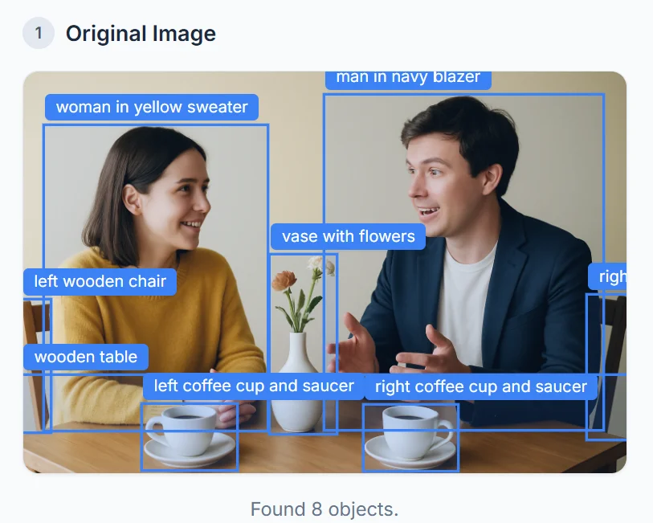
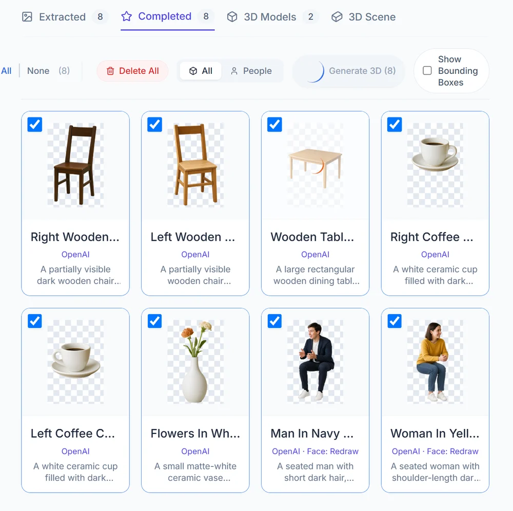

# One Image to 3D Scene

[日本語](README-jp.md)

Reconstruct a 3D scene from a **single monocular RGB image**.

Instead of reconstructing a point cloud from multiple views or a depth sensor, this system takes an **object-based** approach: it recognizes each object in the image, completes the parts that are hidden or cut off with generative AI, turns each object into a 3D model, and places the models in 3D space using monocular depth estimation.

This is the reference implementation of the paper listed in [Citation](#citation).

<table>
  <tr>
    <td></td>
    <td></td>
  </tr>
  <tr>
    <td align="center">Input: a single photo</td>
    <td align="center">Reconstructed 3D scene</td>
  </tr>
</table>

The sample photo [`samples/two-people-at-table.webp`](samples/two-people-at-table.webp) is AI-generated and is the input used in the paper. You can use it to try the app.

## Pipeline

| # | Phase | Method |
|---|---|---|
| 1 | Object detection | Vision-Language Model (Gemini or OpenAI) returns bounding boxes, labels and detailed descriptions (pose, action, clothing) |
| 2 | Cropping | HTML5 Canvas API |
| 3 | Image completion | Generative AI outpainting (Gemini or OpenAI image generation) restores occluded / cut-off parts while preserving pose, followed by background removal (BRIA RMBG 2.0) |
| 4 | Feature matching | AKAZE (OpenCV.js) + Lowe's ratio test + RANSAC fit of a scale + translation, searched at several image scales, to localize the original crop inside the completed image (unreliable matches fall back to the whole object) |
| 5 | Depth estimation | Depth Anything V2; object depth is the median depth inside the object mask |
| 6 | 3D generation | TRELLIS.2 or Hunyuan3D-2.1 (Hugging Face Spaces) → textured GLB |
| 7 | Scene composition | Three.js; models are aligned to point-cloud bounding boxes (PC Box) built from the depth map |

### Walkthrough (sample photo)

<table>
  <tr>
    <td width="50%"><br><sub><b>1. Detection</b> — 8 objects with labels and boxes (VLM)</sub></td>
    <td width="50%"><br><sub><b>2. Cropping</b> — each object cut out of the photo</sub></td>
  </tr>
  <tr>
    <td width="50%"><br><sub><b>3. Completion</b> — hidden parts generated, background removed</sub></td>
    <td width="50%"><br><sub><b>6. 3D generation</b> — one textured 3D model per object (TRELLIS.2)</sub></td>
  </tr>
  <tr>
    <td width="50%"><br><sub><b>5. Depth estimation</b> — Depth Anything V2 (brighter = nearer)</sub></td>
    <td width="50%"><br><sub><b>7. Scene composition</b> — models placed at the depth of their PC Boxes (people, vase and cups)</sub></td>
  </tr>
</table>

## Requirements

- Node.js 18 or later
- **An API key for Google Gemini or OpenAI** (or both, if you use one for detection and the other for completion)
- **Hugging Face token** (required for 3D generation with TRELLIS.2 / Hunyuan3D-2.1; recommended for background removal and depth estimation, since ZeroGPU usage is counted against your own quota)

## Setup

```bash
git clone https://github.com/IWATSUKI-Masami/one-image-to-3d-scene.git
```

```bash
cd one-image-to-3d-scene
```

```bash
npm install
```

API keys can be entered in the UI, or put in a `.env.local` file (copy `.env.example`):

```bash
cp .env.example .env.local
```

```bash
npm run dev
```

Open `http://localhost:3000` in your browser.

> [!WARNING]
> Variables prefixed with `VITE_` are **embedded into the JavaScript bundle** at build time, and API calls are made directly from the browser. This is fine for running the app locally. **Do not deploy a build that contains your keys to a public server** — anyone could read them. For a public deployment, leave `.env.local` empty and let each user enter their own keys in the UI.

## AI providers and models

Click the AI button in the header to open **AI Settings**, where you choose the providers, enter API keys and change model IDs.

| Task | Providers | Default model |
|---|---|---|
| Object detection, canvas expansion estimate, completion check | Gemini / OpenAI | `gemini-pro-latest` / `gpt-5.6-sol` |
| Image completion (outpainting) | Gemini / OpenAI | `gemini-3-pro-image` / `gpt-image-2.6-sunburst` |

- Model IDs change often. If a model is retired, type a new ID in AI Settings; no code change is needed.
- The results in the paper were obtained with `gemini-3-pro-preview` and `gemini-3-pro-image-preview` (both since shut down). Other providers and models use the same prompts, but detection accuracy and pose preservation may differ.
- API keys are kept in memory only. Providers and model IDs are remembered in the browser.

### Hugging Face Spaces

Background removal, depth estimation and 3D generation call these Spaces. They can be changed under **Hugging Face Spaces** in AI Settings.

| Task | Default Space |
|---|---|
| Background removal | `briaai/BRIA-RMBG-2.0` |
| Depth estimation | `depth-anything/Depth-Anything-V2` |
| 3D generation | `microsoft/TRELLIS.2`, `tencent/Hunyuan3D-2.1` |

The official Spaces run on ZeroGPU, which has a daily quota per user (larger with Hugging Face PRO). To process many objects, duplicate a Space to your account (**Duplicate this Space** on its page), give it a dedicated GPU, and enter its ID. Dedicated GPUs are billed per hour — pause the Space when you are done.

- **TRELLIS.2**: use an **A100** (80 GB). The TRELLIS.2 authors require at least 24 GB and verified only A100/H100, and the Space installs CUDA extensions prebuilt for specific GPUs (the current official Space targets the ZeroGPU hardware), so smaller or different GPUs may fail.
- **Background removal / depth estimation**: a T4 is enough. Private Spaces need an HF token with read access.

## Usage

1. **Detect & Crop** — upload an image and analyze the scene. Detected objects are cropped automatically.
2. **Image Completion** — complete the cropped objects (full body for people, missing parts for objects). The background is removed after completion.
3. **3D Generation** — convert the completed images into 3D models.
4. **3D Scene** — generate the depth map and view the assembled scene. Positions can be adjusted with the transform controls, and the scene can be exported as glTF/GLB.

Projects (images, depth map, models and scene layout) can be saved and loaded.

## Project structure

```
├── App.tsx                 # Main application (UI and workflow)
├── components/             # React components (3D viewers, cards, overlays)
├── services/
│   ├── aiService.ts        # Prompts for detection, completion and checks
│   └── ai/                 # Provider layer (Gemini / OpenAI) and default models
├── utils.ts                # Cropping, AKAZE matching, depth, 3D generation APIs
├── types.ts                # Type definitions
├── samples/                # Sample photo
└── docs/                   # Development history, roadmap and README images
```

## Future work

Planned: [Pixal3D](https://huggingface.co/TencentARC/Pixal3D) (pixel-aligned image-to-3D) as a 3D generator, and local 3D generation with [ComfyUI](https://www.comfy.org/) on your own GPU. See [docs/roadmap.md](docs/roadmap.md).

## Citation

If you use this software in your research, please cite:

```bibtex
@techreport{iwatsuki2026oneimage3d,
  author      = {Iwatsuki, Masami and Watanabe, Mizuki},
  title       = {Depth-Based High-Precision {3D} Scene Reconstruction from a Single Monocular Image: Object-Based Approach Using Generative {AI}},
  institution = {The Institute of Electronics, Information and Communication Engineers},
  type        = {IEICE Technical Report},
  number      = {KBSE2025-61},
  pages       = {73--78},
  year        = {2026},
  month       = mar
}
```

## License

[MIT](LICENSE)

This repository contains only the application code. The external models and APIs it calls (Gemini, OpenAI, TRELLIS.2, Hunyuan3D-2.1, Depth Anything V2, BRIA RMBG 2.0, etc.) are governed by their own licenses and terms of use; check them before use, especially for commercial purposes.

In particular, the [Tencent Hunyuan 3D 2.1 Community License](https://github.com/Tencent-Hunyuan/Hunyuan3D-2.1/blob/main/LICENSE) does not apply in the European Union, the United Kingdom and South Korea; use TRELLIS.2 (MIT) there.

## Changelog

See [CHANGELOG.md](CHANGELOG.md). Development before the public release took place in a private predecessor repository; its history is summarized in [docs/development-history.md](docs/development-history.md).
