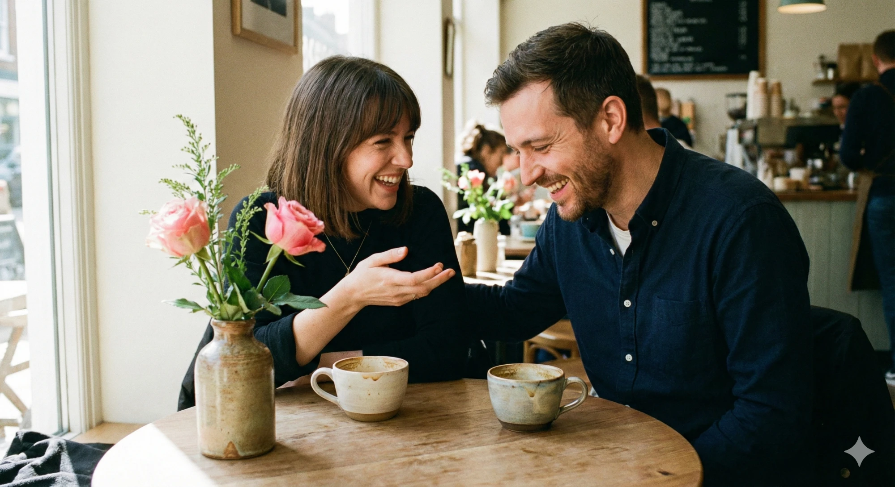
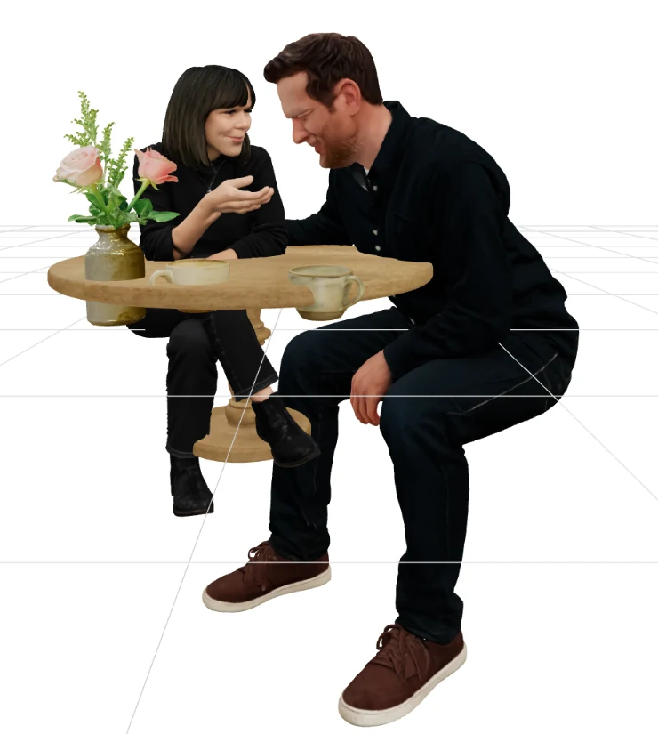
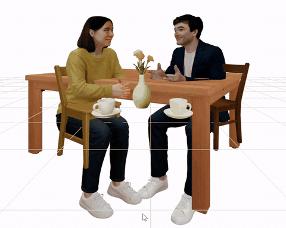
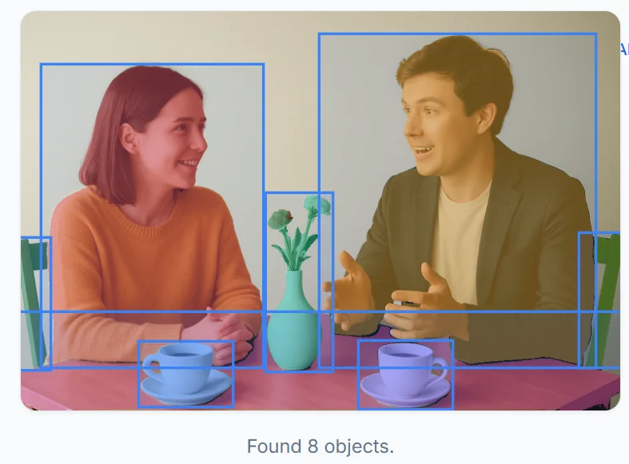
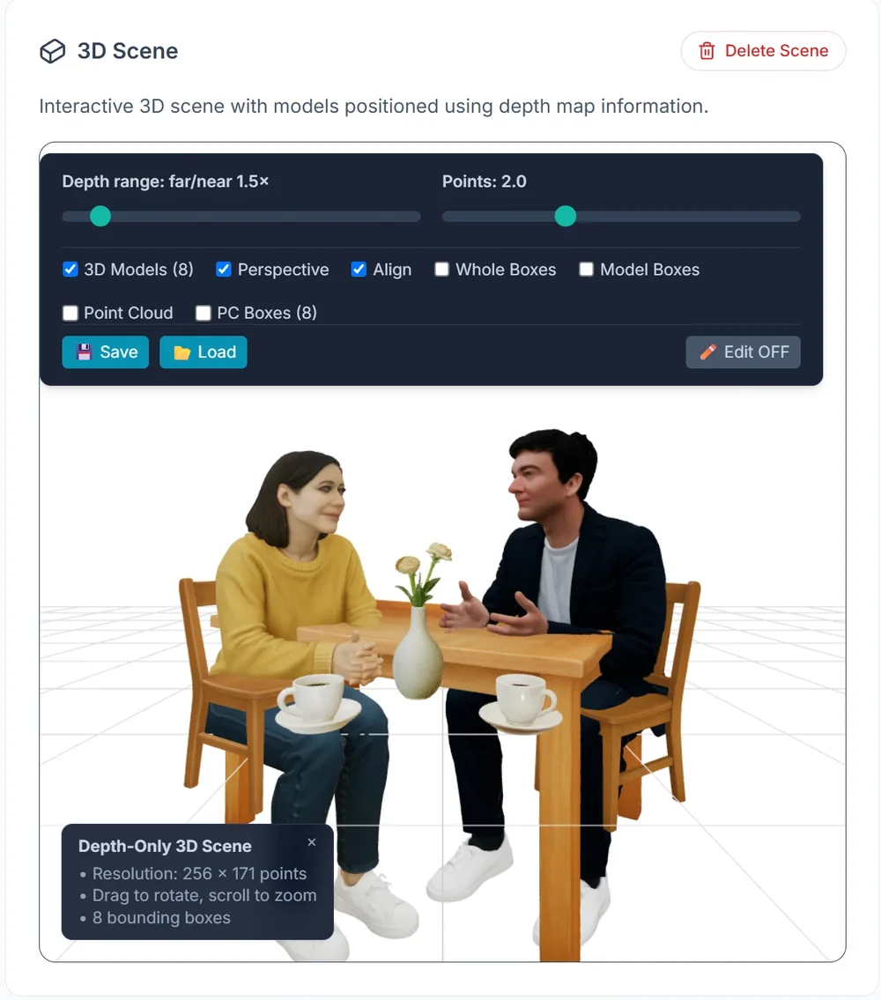
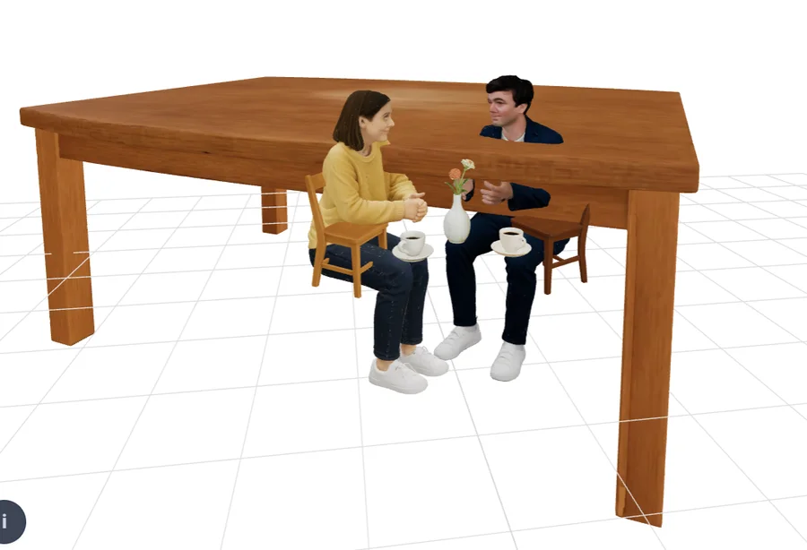
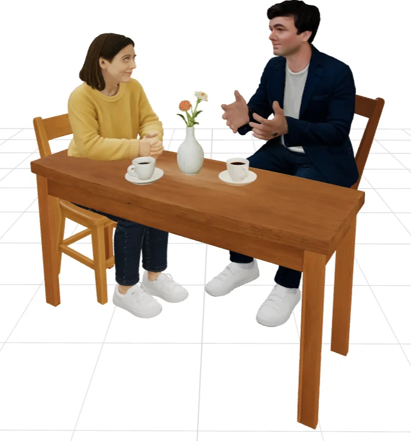

# One Image to 3D Scene

[日本語](README-jp.md)

Reconstruct a 3D scene from a **single monocular RGB image**.

Instead of reconstructing a point cloud from multiple views or a depth sensor, this system takes an **object-based** approach: it recognizes each object in the image, completes the parts that are hidden or cut off with generative AI, turns each object into a 3D model, and places the models in 3D space using monocular depth estimation.

This is the reference implementation of the paper listed in [Citation](#citation).

<table>
  <tr>
    <td></td>
    <td></td>
  </tr>
  <tr>
    <td align="center">Input: a single photo</td>
    <td align="center">Reconstructed 3D scene (automatic, seen from the photo's camera)</td>
  </tr>
</table>

All sample photos are AI-generated, and you can use them to try the app: [`samples/cafe-couple.webp`](samples/cafe-couple.webp) (above, generated with Gemini) and [`samples/table-talk.webp`](samples/table-talk.webp), the input used in the paper and in the walkthrough below. Two more photos were used to test the method on other scenes: [`samples/office-desk.webp`](samples/office-desk.webp) (a desk without people, with a chair cut off at the right border, an office chair hidden behind the desk and a laptop seen from the back of its screen) and [`samples/woman-at-desk.webp`](samples/woman-at-desk.webp) (a person seen from the side at an L-shaped desk, with a bookcase and a floor lamp cut off at the borders; correct the desk's annotation to "L-shaped" if the VLM describes it as rectangular).

The scene above is the automatic result. The placement can also be adjusted by hand in edit mode (**Edit ON** in the 3D Scene tab); see *Edited by hand* in the walkthrough below.

<p align="center"></p>
<p align="center"><sub>The 3D scene of the paper's sample, turned around in the app (automatic placement). Demo videos of the whole process: <a href="docs/videos/demo.mp4"><code>docs/videos/demo.mp4</code></a> (33 s, English captions) and <a href="docs/videos/demo-ja.mp4"><code>docs/videos/demo-ja.mp4</code></a> (24 s, square, Japanese captions)</sub></p>

An article explaining the method and its implementation (in Japanese) is on Qiita: [生成AIで隠れた部分を描き足しても位置がずれない：1枚の写真から3Dシーンを組み立てる](https://qiita.com/miwastsuki2026/items/08ce2be1fc32118401ae).

## Highlights

- **Partly visible objects at the right size.** While generative AI draws the hidden parts, the visible part is kept at a known place, so its place in the completed image is known without feature matching and the 3D model is placed by it. The chairs at the edges of the paper's sample, of which only a thin part of the backrest is visible, stand behind the people.
- **Orientation by render-and-compare.** Each 3D model is rendered while turning around the vertical axis and compared with its completed image (silhouette, aspect ratio, shading), then turned to face the camera as in the photo.
- **AI that understands the photo before it rearranges the scene.** In **Arrange**, a vision-language model first analyzes the original photo (real sizes and relations such as what rests on what and who sits at what). It then corrects the 3D scene in rounds, checking renderings against the photo, physical checks and the relations. One set of general instructions is used for every photo, with nothing tailored to the test photos. With Claude, physical issues went to 0 on all four sample photos, including two not used for development (see [Semantic arrangement with AI](#semantic-arrangement-with-ai-arrange)).
- **Runs in your browser.** React and Three.js; object masks (SAM 2.1) and the alignment are computed in the browser. Detection and completion use your own OpenAI or Gemini key, and 3D generation uses Hugging Face Spaces.

## Pipeline

| # | Phase | Method |
|---|---|---|
| 1 | Object detection | Vision-Language Model (OpenAI or Gemini) returns bounding boxes, labels and detailed descriptions (pose, action, clothing) |
| 2 | Cropping | HTML5 Canvas API |
| 3 | Image completion | Generative AI outpainting (OpenAI or Gemini image generation) restores occluded / cut-off parts while preserving pose. OpenAI returns a transparent background; Gemini completions go through background removal (BRIA RMBG 2.0 or 3.0) |
| 4 | Locating the visible part | The crop keeps a known box through completion (layout-preserving canvas, OpenAI edit mask), checked and corrected by correlation near that box; AKAZE (OpenCV.js) + Lowe's ratio test + RANSAC fit of a scale + translation is the fallback when the image model moved it |
| 5 | Depth estimation | Depth Anything V2; object depth is the median depth inside the object mask |
| 6 | 3D generation | TRELLIS.2 or Hunyuan3D-2.1 (Hugging Face Spaces) → textured GLB |
| 7 | Scene composition | Three.js; models are aligned to point-cloud bounding boxes (PC Box) built from the depth map. By default the boxes are back-projected with perspective (see Usage) |
| 8 | Front alignment | Each model is rendered around the vertical axis and compared with its completed image (silhouette, aspect ratio, brightness), then turned to match it and by the view angle, so it faces the camera as in the photo |
| 9 | Semantic arrangement (optional) | **Arrange** in the 3D scene: a vision model (Claude by default, or OpenAI / Gemini) first analyzes the photo (what the scene is, each object's real size, and relations such as what rests on what and who sits at what), then compares the photo with renderings of the scene (from the photo's camera, from above and obliquely) and moves, turns and scales the models with a tool until objects rest on their supports, seated people sit on their chairs, and sizes and orientations match the photo; it sees new renderings after each round |

### Walkthrough (sample photo)

Results of the current version. Detection and completion use OpenAI (only the right chair in the completion image was completed with Gemini), 3D generation uses TRELLIS.2, and people were completed with the **Calm** face style. The scene uses perspective placement (far/near ratio 1.5) and front alignment, and each model is placed by the box of its visible part, kept through completion (the paper's box placement).

<table>
  <tr>
    <td width="50%"><br><sub><b>Detection</b> — the VLM finds 8 objects and gives each a label and a box.</sub></td>
    <td width="50%"><br><sub><b>Segmentation</b> — SAM 2.1, running in the browser, segments the visible pixels of each object from its box. Only thin strips of the chairs' backrests are visible at the borders.</sub></td>
  </tr>
  <tr>
    <td width="50%"><br><sub><b>Cropping</b> — each object is cut out of the photo.</sub></td>
    <td width="50%"><br><sub><b>Completion</b> — the hidden parts are drawn with a transparent background. The visible part stays in place (green box, "Part: kept"), so no feature matching is needed.</sub></td>
  </tr>
  <tr>
    <td width="50%"><br><sub><b>3D generation</b> — one textured 3D model per object (TRELLIS.2).</sub></td>
    <td width="50%"><br><sub><b>Depth estimation</b> — the depth map from Depth Anything V2 (brighter is nearer).</sub></td>
  </tr>
  <tr>
    <td width="50%"><br><sub><b>Scene composition</b> — the 8 objects are placed with perspective at the depth of their PC Boxes. The chairs, of which only the backrests are visible, stand behind the people; the table, visible only as the front of its top, is still placed only roughly.</sub></td>
    <td width="50%"><br><sub><b>3D Scene tab</b> — the scene and its controls: depth range, point size, <b>Perspective</b>, <b>Align</b> (front alignment), boxes and point cloud, <b>Save</b> / <b>Load</b> of the layout, <b>GLB</b> export, <b>✨ Arrange</b> (semantic arrangement with AI), <b>Match</b> (photo match), <b>Ref</b> (reference analysis for evaluation), and <b>Edit</b> for moving models by hand.</sub></td>
  </tr>
  <tr>
    <td width="50%"><br><sub><b>Edited by hand</b> — the table and chairs of the sample moved and resized in edit mode (<b>Edit ON</b>, Move and Scale), seen from above: the cups and the vase now stand on the table and the people sit on their chairs.</sub></td>
    <td width="50%"></td>
  </tr>
</table>

## Semantic arrangement with AI (Arrange)

The automatic placement puts each object at the depth estimated for it, one object at a time. Distances along the line of sight and sizes are therefore rough, and relations between objects often break: cups float above the table or sink into it, people do not sit on their chairs, a table comes out half its real height. **Arrange** lets a vision-language model correct the scene in two stages, so that it is consistent both with the photo and with how the objects in it relate to each other.

### Two stages: understand the photo first, then place

1. **Semantic analysis of the original photo.** Before it sees the 3D scene, the model describes the photo with a tool (`report_scene`):
   - what the scene is;
   - the real height and width of each object, and which objects give the scale (e.g. seated adults, a standard desk);
   - the relations between objects: *on* (with whether the contact is visible in the photo), *sits on*, *sits at*, *faces*, *in front of*.
2. **Placement in rounds, with the analysis as the plan.** In each round the model sees:
   - the photo and three renderings of the scene (from the photo's camera, from above and obliquely);
   - the list of objects with measured values.
   
   It then calls `update_placements` with edits for several objects at once. The edits include `scale`, `scale_axes`, `rotate_y_deg`, `along_ray`, `rest_on` / `drop_on` and `place_under`, and the model can also set the photo's camera and the floor. After every round the app measures the new scene and returns the values to the model:
   - **photo match**: the IoU of each model's visible part, seen from the photo's camera, with the object's mask in the photo;
   - **physical checks** on the meshes: floating, sunk, inside another model;
   - **relation checks** against the model's own analysis: unmet supports, a person inside the table's outline, sizes far from the real ones, a model turned away from the orientation measured by front alignment.
   
   The model ends with `finish` and a summary of what it changed and what still differs from the photo.

The tools keep each object where it is in the photo. `along_ray` changes an object's distance and size together. `rest_on` slides an object along the line of sight onto its support, and the model uses it when the contact is visible in the photo. When the contact is hidden (legs below the photo's edge), it uses `drop_on`, which moves the object straight down or up instead.

### No instructions tailored to the photos

- **One set of instructions for every photo.** The instructions contain only general rules: how to use the analysis, supports and contacts, seated people, real sizes, the camera, and how to use the tools and measurements. They name no test photo and none of its objects or layouts. Everything specific to a photo comes from the model's own analysis of it.
- **Developed on two photos, tested on two others.** The method was developed on two photos (`cafe-couple`, `table-talk`). An earlier version had grown rules for people at café tables; it was replaced by the analysis stage. The examples in the instructions describe common situations (e.g. a table seen corner-on), not these photos; the examples for the camera were rewritten for this reason. The same instructions were then run unchanged on two photos not used for development (`office-desk`: a desk without people; `woman-at-desk`: a person at an L-shaped desk).
- **Traceable.** Each run records the version of the instructions, a hash of the prompts and tools (all results below: `d5d766f8`), and the version of the app.
- **References kept from the model.** The reference analyses used for evaluation are never shown to the model.

### Other features

- **Real sizes from the analysis.** The model decides the scale from the objects the analysis names as reliable (people, standard furniture). It then gives every object its real height by scaling it uniformly.
- **People keep their body proportions.** Stretching a person along one axis is refused; people can only be scaled uniformly. For every object the change in proportions from the generated model is recorded.
- **The photo's camera is estimated when needed.** The scene assumes a level camera with a 60° field of view. When real sizes and places in the photo conflict, the model can set the camera's downward tilt and field of view; the models keep their place and apparent size in the photo. In the runs below, the model did this only once (`table-talk`, 8°).
- **The best state is kept.** If the last round made the scene worse, the run returns to its best round. The score for this is the photo match minus the physical and relation issues.
- **The same method with several AIs.** Claude, OpenAI and Gemini use the same instructions and tools.
- **Everything recorded for evaluation:** a text report, per-object and per-round CSVs (times, tokens, cost, edits) and an image sheet of what the model saw in each round.

### Evaluation with reference analyses checked by a person

A person checked one reference analysis per photo: the relations, contact visibility and real sizes (`samples/*.analysis.json`). The reference is made by answering questions about an AI draft: correct, wrong or unknown, with corrections. Uncertain relations are kept but not scored. With **📐 Ref**, a run is evaluated against it in two ways:

- **Relation issues:** relations and sizes of the reference that the scene does not satisfy.
- **The model's own analysis:** recall and precision of its relations, whether it judged contact visibility correctly, and the error of the real heights.

### Results

The best final runs with Claude (`claude-opus-5-5`, effort high, at most 6 rounds; instructions `d5d766f8`). The numbers before each arrow are for the automatic placement.

| Photo | Used for development | Photo match (mean IoU) | Weighted by area in the photo | Physical issues | Relation issues (reference) | Relations found by the analysis | Time / cost |
|---|---|---|---|---|---|---|---|
| cafe-couple | yes | 0.376 → **0.678** | 0.374 → **0.714** | 6 → **0** | — ¹ | 13/14 | 113 s / US$0.64 |
| table-talk | yes | 0.274 → **0.509** | 0.263 → **0.637** | 7 → **0** | 13 → 1 | 19/22 | 195 s / US$0.76 |
| office-desk | **no** | 0.425 → 0.437 | 0.648 → 0.653 | 5 → **0** | 1 → **0** | 11/11 | 98 s / US$0.65 |
| woman-at-desk | **no** | 0.294 → **0.405** | 0.382 → **0.583** | 8 → **0** | 5 → 1 ² | 13/13 | 148 s / US$0.96 |

¹ Not counted: the reference was matched to the wrong objects in this run. That has since been fixed; the analysis was counted by hand.
² The remaining issue is a false one. The woman sits in the inner corner of the L-shaped desk, which a check on the desk's outline (a rectangle) counts as inside the desk.

- **Physical issues reached 0 on every photo.** On the two photos not used for development, the analysis found every relation of the references.
- **The weighted photo match counts each object by its area in the photo.** Objects seen only as thin strips at the borders (the chairs) or hidden behind others otherwise weigh as much as the people in the mean. `office-desk` matched the photo well from the start, so it changed little.
- **In `table-talk`, the analysis matches the photo.** It reads that the two people sit on both sides of a corner of the table. The model keeps the table corner-on, as front alignment measured it, and puts the corner between them. In this run the generated table was about 4 m wide; the model scaled it down to real size.

<table>
  <tr>
    <td width="33%"><br><sub><b>Photo</b> — two people sit on both sides of a corner of the table.</sub></td>
    <td width="33%"><br><sub><b>Before Arrange</b> — automatic placement: the generated table is about 4 m wide and stands behind the people; cups and chairs float.</sub></td>
    <td width="33%"><br><sub><b>After Arrange (Claude)</b> — the table at real size in front of the people, kept corner-on; cups and vase on the top, each person on a chair. Physical issues 7 → 0.</sub></td>
  </tr>
</table>

Claude and OpenAI (`gpt-5.6-sol`) on the same four scenes (same models, same starting placement):

| | Claude | OpenAI |
|---|---|---|
| Photo match, mean of the four photos | **0.507** | 0.480 |
| Weighted photo match, mean | **0.647** | 0.614 |
| Runs with physical issues at 0 | **4/4** | 3/4 |
| Relations found by the analysis | 56/60 | 55/60 |
| Error of the real heights in the analysis | **2.9%** | 12.2% |
| Objects other than people stretched along one axis | 3 (tables and a desk generated too low) | 10 (cups, chairs, a wastebasket, a lamp; tables flattened) |
| Rounds, mean | **3.0** | 5.0 |

<table>
  <tr>
    <td width="50%"><br><sub><b>Claude</b> — the table top keeps the shape of the generated model; the table was shrunk to real size (photo match 0.509, weighted 0.637).</sub></td>
    <td width="50%"><br><sub><b>OpenAI</b> — the same scene; the table's depth was cut to about a third (its width only to 0.8) to fit its partly hidden outline in the photo, so it became long and narrow (photo match 0.575, weighted 0.656).</sub></td>
  </tr>
</table>

- **Understanding of relations:** both models understand the relations about equally well.
- **Real sizes:** they differ in estimating real sizes, and in whether they keep the objects' shapes. OpenAI raised the photo match on one photo by flattening the table to fit its partly hidden outline, and it lowered the match on `woman-at-desk`.
- **Gemini:** in earlier runs on the two development photos it was slower and less stable (see [docs/roadmap.md](docs/roadmap.md)).

### Limits seen in the runs

- **Shapes and poses of the generated models set the ceiling.** Placement cannot fix them:
  - a person generated upright when leaning forward in the photo;
  - a person gesturing with wide arms;
  - the far section of an L-shaped desk generated too thin, because its depth is not visible in the photo.
- **Relation checks use bounding boxes.** They cannot represent non-convex furniture such as an L-shaped desk.
- **Most of the relations the analysis misses are front-to-back orders** between small objects (a vase and a cup).

<table>
  <tr>
    <td width="50%"><br><sub><b>Photo</b> (not used for development) — a woman at the inner corner of an L-shaped desk.</sub></td>
    <td width="50%"><br><sub><b>After Arrange (Claude)</b> — the woman in the corner of the L, items on the desk, shelves and lamp on the floor (physical issues 8 → 0). The far section of the desk was generated too thin: its depth is not visible in the photo.</sub></td>
  </tr>
</table>


## Requirements

- Node.js 18 or later
- **An API key for OpenAI or Google Gemini** (or both, if you use one for detection and the other for completion)
- Optional, for **Arrange** in the 3D scene (semantic arrangement): **an Anthropic API key** to use Claude (default), or choose OpenAI or Gemini in AI Settings and use their key
- **Hugging Face token** (required for 3D generation with TRELLIS.2 / Hunyuan3D-2.1; recommended for background removal and depth estimation, since ZeroGPU usage is counted against your own quota). Create a **Read** token in **Settings → Access Tokens** on Hugging Face and enter it in the **HF Token** field at the top right of the app; see [docs/hugging-face-spaces.md](docs/hugging-face-spaces.md)

## Setup

```bash
git clone https://github.com/IWATSUKI-Masami/one-image-to-3d-scene.git
```

```bash
cd one-image-to-3d-scene
```

```bash
npm install
```

API keys can be entered in the UI, or put in a `.env.local` file (copy `.env.example`):

```bash
cp .env.example .env.local
```

```bash
npm run dev
```

Open `http://localhost:3000` in your browser.

> [!WARNING]
> Variables prefixed with `VITE_` are **embedded into the JavaScript bundle** at build time, and API calls are made directly from the browser. This is fine for running the app locally. **Do not deploy a build that contains your keys to a public server** — anyone could read them. For a public deployment, leave `.env.local` empty and let each user enter their own keys in the UI.

## AI providers and models

**AI Settings** is the app's settings dialog. Open it with the round button at the top right of the screen, to the left of the HF Token field. The button reads **Set API Keys** (grey) until the API keys are set, and then shows the providers in use, e.g. **AI: Gemini / Gemini** (green). The dialog also opens automatically when you start a step that needs a missing key.

In AI Settings you can set:

| Section | What it sets |
|---|---|
| Object detection & checks | Provider for detection and checks (OpenAI / Gemini; default OpenAI) |
| Arrange (3D scene) | Provider for Arrange (Claude / OpenAI / Gemini; default Claude; OpenAI and Gemini use their detection model) and the maximum number of rounds per run (default 6) |
| Image completion | Provider for completion (OpenAI / Gemini; default OpenAI) |
| Background removal | Background-removal model (RMBG 2.0 / RMBG 3.0; default RMBG 2.0). Only used with Gemini completion; disabled when OpenAI is selected |
| API keys | OpenAI, Gemini and (for Arrange) Anthropic API keys |
| Models | Model IDs |
| Hugging Face Spaces | Space IDs for background removal, depth estimation and 3D generation (e.g. your duplicated Spaces) |

Default models:

| Task | Providers | Default model |
|---|---|---|
| Object detection, canvas expansion estimate, completion check | OpenAI / Gemini | `gpt-5.6-sol` / `gemini-pro-latest` |
| Image completion (outpainting) | OpenAI / Gemini | `gpt-image-2.6-sunburst` / `gemini-3-pro-image` |
| Arrange in the 3D scene (optional) | Anthropic / OpenAI / Gemini | `claude-opus-5-5` / the detection models above |

- OpenAI returns completions with a transparent background. Gemini cannot, so its completions go through background removal; a failed removal is marked on the completed card.
- OpenAI is the default for both detection and completion.
- Background removal uses **BRIA RMBG 2.0** (default) or **BRIA RMBG 3.0**, selected under **Background removal** in AI Settings. The choice is disabled while OpenAI does the completion, since it is not used then. Both Spaces have the same API; RMBG 2.0 is much lighter, so a duplicate of it runs on a T4.
- Model IDs change often. If a model is retired, type a new ID in AI Settings; no code change is needed.
- The results in the paper were obtained with `gemini-3-pro-preview` and `gemini-3-pro-image-preview` (both since shut down). Other providers and models use the same prompts, but detection accuracy and pose preservation may differ.
- API keys are kept in memory only. Providers and model IDs are remembered in the browser.

### Hugging Face Spaces

Background removal, depth estimation and 3D generation call these Spaces. They can be changed under **Hugging Face Spaces** in AI Settings.

| Task | Default Space |
|---|---|
| Background removal (RMBG 3.0 / 2.0) | `briaai/BRIA-RMBG-3.0`, `briaai/BRIA-RMBG-2.0` |
| Depth estimation | `depth-anything/Depth-Anything-V2` |
| 3D generation | `microsoft/TRELLIS.2`, `tencent/Hunyuan3D-2.1` |

The official Spaces run on ZeroGPU, which has a daily quota per user (larger with Hugging Face PRO). To process many objects, duplicate a Space to your account (**Duplicate this Space** on its page), give it a dedicated GPU, and enter its ID. Dedicated GPUs are billed per hour — pause the Space when you are done.

**Step-by-step guide** (tokens, accepting model terms, the `HF_TOKEN` secret, the changes a Hunyuan3D-2.1 duplicate needs, and common errors): [docs/hugging-face-spaces.md](docs/hugging-face-spaces.md)

- **TRELLIS.2**: use an **A100** (80 GB). The TRELLIS.2 authors require at least 24 GB and verified only A100/H100, and the Space installs CUDA extensions prebuilt for specific GPUs (the current official Space targets the ZeroGPU hardware), so smaller or different GPUs may fail.
- **Hunyuan3D-2.1**: an **A100** (80 GB). Shape plus texture generation needs about 29 GB, and the Space builds its CUDA extensions for A100/A10G-class GPUs. The official Space is built for ZeroGPU, so a duplicate needs a few file changes (Python 3.10, Gradio 5.33.0, pinned torch, no `bpy`, `custom_rasterizer` compiled from source, no `zero.startup()`); see the guide.
- **Depth estimation**: a T4 is enough.
- **Background removal**: BRIA RMBG 3.0 is a 4-step diffusion model of about 25 GB (bf16 weights), so it needs a 48 GB GPU such as an **L40S**; a T4 or 24 GB GPU runs out of memory. To use a T4, select RMBG 2.0 and duplicate `briaai/BRIA-RMBG-2.0` instead. The RMBG 3.0 models are gated: accept the terms of `briaai/RMBG-3.0` and `briaai/Fibo-2.0-edit-turbo` and add your HF token as the Space secret `HF_TOKEN`.
- With **OpenAI completion** the background is already transparent, so no background-removal Space is needed at all.
- BRIA RMBG models are released for non-commercial use (CC BY-NC 4.0); check the model card before other uses. Private Spaces need an HF token with read access.

## Usage

1. **Detect & Crop** — upload an image and analyze the scene. Detected objects are cropped automatically.
   - **Annotations** — the label and description of each object can be edited on its card (pencil icon) before completion. The description is part of the completion prompt, so a wrong guess about the hidden parts can be corrected (e.g. "an L-shaped desk; the right part extends to the back" instead of "a rectangular desk"). **EN / 日本語** switches the cards between English and Japanese; Japanese annotations are translated by the VLM, and an edit in Japanese is translated into English for the prompts.
   - **Object masks** (automatic, right after detection; progress is shown on the **Segment Objects** button above the photo) — segments the visible pixels of each detected object with [SAM 2.1](https://huggingface.co/onnx-community/sam2.1-hiera-small-ONNX), prompted with its box. It runs in the browser (transformers.js; WebGPU if available, otherwise WebAssembly) and needs no key or token; the model (about 70–90 MB) is downloaded from Hugging Face on first use and cached by the browser. The masks are shown over the photo (**Masks** checkbox), saved with the project, and used for the depth of each object (Eq. (4)) instead of the completed image's alpha. They also let the completion draw and lock only the object's pixels (step 2); a completion started while the photo is still being segmented waits for the masks. **Segment Again** runs it again (e.g. after a failure, or for a project saved without masks).
2. **Image Completion** — complete the cropped objects (full body for people, missing parts for objects). The background is removed after completion. The VLM first estimates, from the whole photo, how far each object extends beyond its box on each side; the crop is then placed on a canvas of the image model's output size with room for the hidden parts. With the object masks, only the object's pixels are drawn and, with OpenAI, an edit mask keeps them unchanged. When the visible part stays in place (checked by correlation near its box, which also corrects small shifts and size changes by the image model), its box in the completed image is known without feature matching (card caption "Part: kept"); otherwise AKAZE matching is used ("Part: matched"). Each completion is checked for cut-off parts and unnatural proportions (e.g. shortened legs) and retried up to twice on a larger canvas; a completion whose visible part moved is retried on the same canvas (best of up to three attempts). The image model also receives the whole photo with the object marked by a red box, as a reference for its appearance and viewpoint. **Face** sets how faces of people are drawn: **Calm** (default; sharp face with a relaxed, closed-mouth expression, since open mouths and teeth look uncanny in 3D), **Redraw** (sharp face, same expression), **Mannequin** (smooth face without painted features) or **As in photo**. Each completed card shows the provider and face style used (e.g. "OpenAI · Face: Calm"). People are always generated in 3D at a higher resolution.
3. **3D Generation** — convert the completed images into 3D models. The generator does not always keep the viewpoint of the completed image (e.g. a chair seen obliquely may come back facing another way), so each model is then rendered at angles around the vertical axis and compared with its completed image (silhouette overlap, aspect ratio, brightness); the best angle turns the model so that its front view matches the image (front alignment). The card viewer, the visible-part box and the scene use it; the **Align** checkbox in the scene turns it off.
4. **3D Scene** — generate the depth map and view the assembled scene. Positions can be adjusted with the transform controls, and the scene can be exported as glTF/GLB.
   - **Perspective** (checkbox, on by default): the point cloud, the PC Boxes and the models are back-projected through a pinhole camera at the origin with an assumed 60° horizontal field of view, and the depth map is read as disparity (inverse depth), which is what Depth Anything V2 outputs. Depth Anything V2 stretches its output over the full range for every image, so the ratio between the farthest and the nearest point is unknown: with Perspective on, the **Depth** slider sets this far/near ratio (default 1.5, chosen so that in the sample photo a cup's size relative to a person's head is realistic; use larger values for scenes with more depth). Objects then keep their real relative size: a cup near the camera is no longer as large as a person further away, and the scene seen from its initial camera (the photo's camera) looks like the photo. **Uncheck it to reproduce the paper's placement**, which keeps every object at its size in the image and maps brightness linearly to depth, so objects near the camera end up magnified.
Projects (images, depth map, models, and the placements set by hand in the 3D scene with its settings and camera) can be saved and loaded. Processing details are also kept with the project and shown without the browser console: each completed card shows the number of attempts (hover for each attempt's check result and placement score), and each 3D model card shows its front-alignment angle and score. **Stats** in the header downloads them as a CSV file, one row per completed object (sides of the image the object touches, mask coverage, estimated hidden extent, edit mask, how the visible part was located, attempts, placement score, alignment angle/score/IoU, processing times) — for evaluating the method on your own photos.

### Cost: keeping AI usage low

The automatic placement aims for accuracy, and that costs API calls (OpenAI / Gemini credits) and GPU time:

| Step | Calls |
|---|---|
| Detection | 1 VLM call per photo |
| Completion (per object) | 1 VLM call (how far the object extends beyond its box), then per attempt 1 image generation (with the whole photo as a second, reference image) and 1 VLM check. An attempt is repeated, up to 3 attempts, when parts are cut off, the proportions look wrong or the visible part moved — so one object can cost up to 3 image generations and 4 VLM calls. With **Attempts: 1** it is 1 image generation and 1 VLM call |
| 3D generation (per object) | 1 Hugging Face Space call (GPU time / ZeroGPU quota, not API credits); people use a higher resolution |
| Object masks (SAM 2.1), front alignment, depth-based placement | Run in the browser (the depth map is 1 Space call per photo); no API credits |
| Arrange in the 3D scene (optional, per run) | One call for the scene analysis (the photo) and up to about 8 calls for the placement; each sends the photo and three renderings (only when you press **Arrange**) |

The repeated attempts are there so that the objects can be placed automatically. **If exact automatic placement is not important to you and you are going to adjust the scene yourself, use only what you need:**

- Set **Attempts** (next to **Complete**) to **1 (fewest credits)**: each object is completed once, without the check and the retries.
- Complete and generate 3D models only for the objects you want (select their cards). For example, leave out the partly visible chairs or the table.
- Accept the first result: do not complete an object again just because its card shows "Part: matched" or "Part: not found"; correct its placement by hand instead.
- Adjust the scene by hand: turn on **Edit ON** in the 3D scene, click a model, and move / rotate / scale it with the transform controls (**Reset** restores the automatic placement). With **Uniform** (on by default in Scale), any scale handle scales all axes by the same factor; turn it off to scale one axis only. **Undo** / **Redo** (Ctrl+Z / Ctrl+Y) step through the moves, rotations, scales and resets. **Save** in the scene panel saves the layout — where each model is, the scene settings and the camera — as a small JSON file (a few KB; `<photo name>_layout-edited_<date-time>.json` if models were placed by hand, otherwise `_layout_`); the models are not included, so load it with **Load** into the same project. Hand placements are also kept when the scene is rebuilt (e.g. after changing the depth range) and are saved with the project (**Save** in the header); the layout file is for keeping or sharing several placements of the same project. **GLB** exports the placed models as one GLB file for other 3D software (large, since it contains every model).
- Or let a vision model arrange it: **✨ Arrange** in the scene panel (needs **Perspective** on, and the API key of the provider chosen under **Arrange** in AI Settings: Claude by default, or OpenAI or Gemini). The model first analyzes the photo (scene, real sizes, relations: on, sits on, sits at, faces, in front of; shown in the log and saved in the report), then compares the photo with renderings of the scene and changes the placements in a few rounds, using the analysis as its plan (it can also set the photo camera's downward tilt and field of view, assumed level and 60°, when real sizes and places in the photo conflict; the models keep their place and apparent size in the photo); the progress and elapsed time are shown at the bottom left (**Cancel** stops it); when it ends, the panel turns green ("Arrange finished"), a short chime sounds, and the tab title is marked if the page is in the background. When it has ended (also after a failure or **Cancel**), the panel saves everything for evaluation: **Log** a text report (provider, model, effort, prompt and app version; total time split into waiting for the API and local work, every API call with its time and tokens; tokens and estimated cost at list prices for Claude models; each round's edits as requested by the model, photo match and physical issues; per-object values before and after; the full log with times), **CSV** the per-object photo match and warnings before and after with the run's settings, times, tokens and cost, **Rounds** a CSV of every round and API call, and **Images** one PNG with the photo and the three renderings the model saw in every round. The run's time also appears in the Processing Times panel; closing the panel keeps the log (**📋 Log** shows it again), and the report of the last run is saved with the project. The log ends with the **photo match** before and after (mean IoU between each model's visible part seen from the photo's camera and its mask in the photo), which the model also uses to keep the objects where they are in the photo, and the number of **physical issues** before and after: models floating above the floor or the surface below them, sunk into it, or partly inside another model (measured on the meshes), which the model also gets as warnings for each object, and the number of **relation issues**: relations and real sizes of the analysis that the scene does not satisfy yet (e.g. a cup not on the table top, a person inside the table's outline, a table too low at the people's scale), also given to the model as warnings. For a comparison of providers on a common basis, **📐 Ref** loads a reference analysis checked by a person (e.g. `samples/cafe-couple.analysis.json`); runs are then also evaluated against it (relation issues, and how well the model's own analysis agrees with it), while the model never sees it. **📏 Match** shows the photo match of the current scene at any time as an image over the photo (green = model and mask overlap, red = in the photo only, blue = in the scene only, with each object's IoU and the number of physical issues) and saves it as PNG and the values as CSV, e.g. before and after Arrange for a paper. File names tell the state of the placements: `_scene_` / `_layout_` / `_photo-match_` for the automatic placement, `-edited` when models were placed by hand, and `-arranged-claude` (or `-openai`, `-gemini`) after Arrange, also when corrected by hand afterwards (e.g. `table-talk_scene-arranged-claude_<date-time>.json`). Projects and layout files also record each Arrange run (provider, model, time, rounds, photo match before and after), and the Match CSV starts with the state and the provider. The **✨ Arrange** button shows the chosen provider. The result is a hand placement: it is saved with the project, and **Undo** in edit mode takes back the whole run.
- Object masks, front alignment and the scene itself cost no credits and can stay on.


## Project structure

```
├── App.tsx                 # Main application (UI and workflow)
├── components/             # React components (3D viewers, cards, overlays)
├── services/
│   ├── aiService.ts        # Prompts for detection, completion and checks
│   ├── segmentation.ts     # Object masks in the photo (SAM 2.1 in the browser)
│   ├── frontAlignment.ts   # Turning each model to match its completed image (render and compare)
│   ├── semanticArrange.ts  # Arrange: instructions, tools and the round loop
│   ├── sceneAnalysis.ts    # Arrange: analysis of the photo, relation checks, comparison with a reference
│   ├── arrangeProviders.ts # Arrange: Claude / OpenAI / Gemini adapters
│   ├── arrangeReport.ts    # Arrange: reports and CSVs
│   └── ai/                 # Provider layer (OpenAI / Gemini) and default models
├── utils.ts                # Cropping, AKAZE matching, depth, 3D generation APIs
├── types.ts                # Type definitions
├── samples/                # Sample photos and reference analyses (*.analysis.json)
└── docs/                   # Hugging Face Spaces guide, development history, roadmap, README images and demo video
```

## Future work

Planned: [Pixal3D](https://huggingface.co/TencentARC/Pixal3D) (pixel-aligned image-to-3D) as a 3D generator, local 3D generation with [ComfyUI](https://www.comfy.org/) on your own GPU, better placement of objects of which only a small, featureless part is visible (e.g. the front edge of a table top), handling front/back ambiguities of nearly symmetric objects in the front alignment, calibration of the camera's field of view and the far/near depth ratio (perspective placement currently assumes a 60° field of view), and more natural faces of people. See [docs/roadmap.md](docs/roadmap.md).

## Citation

If you use this software in your research, please cite the paper below. The same information is in [`CITATION.cff`](CITATION.cff), so GitHub's **Cite this repository** button (in the About section) gives it in APA and BibTeX formats.

```bibtex
@techreport{iwatsuki2026oneimage3d,
  author      = {Iwatsuki, Masami and Watanabe, Mizuki},
  title       = {Depth-Based High-Precision {3D} Scene Reconstruction from a Single Monocular Image: Object-Based Approach Using Generative {AI}},
  institution = {The Institute of Electronics, Information and Communication Engineers},
  type        = {IEICE Technical Report},
  number      = {KBSE2025-61},
  pages       = {73--78},
  year        = {2026},
  month       = mar
}
```

## License

[MIT](LICENSE)

This repository contains only the application code. The external models and APIs it calls (Gemini, OpenAI, TRELLIS.2, Hunyuan3D-2.1, Depth Anything V2, BRIA RMBG 3.0 / 2.0, SAM 2.1, etc.) are governed by their own licenses and terms of use; check them before use, especially for commercial purposes.

In particular, the [Tencent Hunyuan 3D 2.1 Community License](https://github.com/Tencent-Hunyuan/Hunyuan3D-2.1/blob/main/LICENSE) does not apply in the European Union, the United Kingdom and South Korea; use TRELLIS.2 (MIT) there.

## Changelog

See [CHANGELOG.md](CHANGELOG.md). Development before the public release took place in a private predecessor repository; its history is summarized in [docs/development-history.md](docs/development-history.md).
